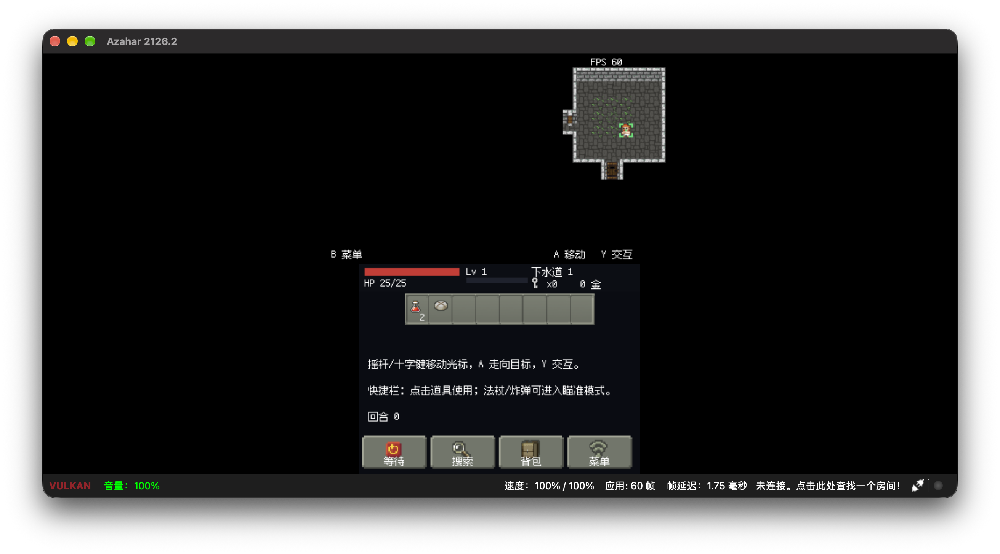
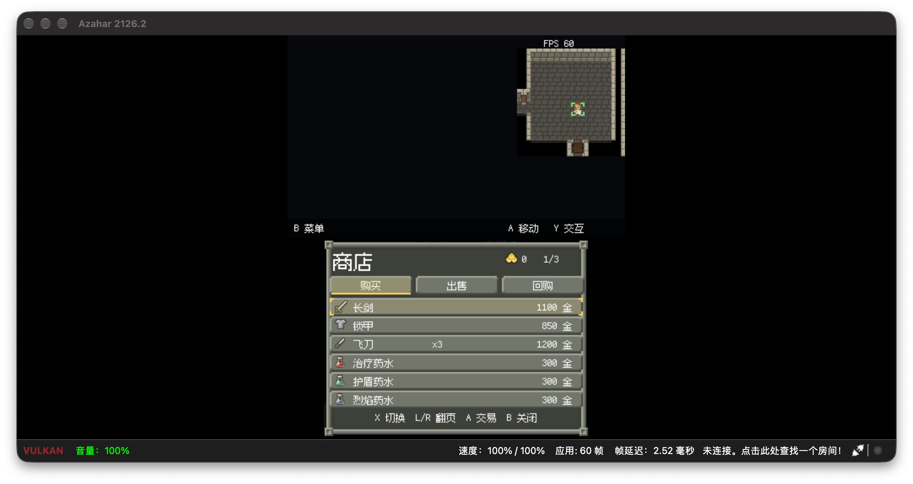
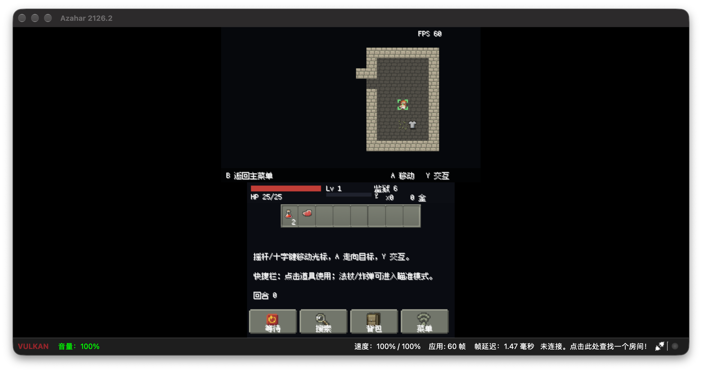
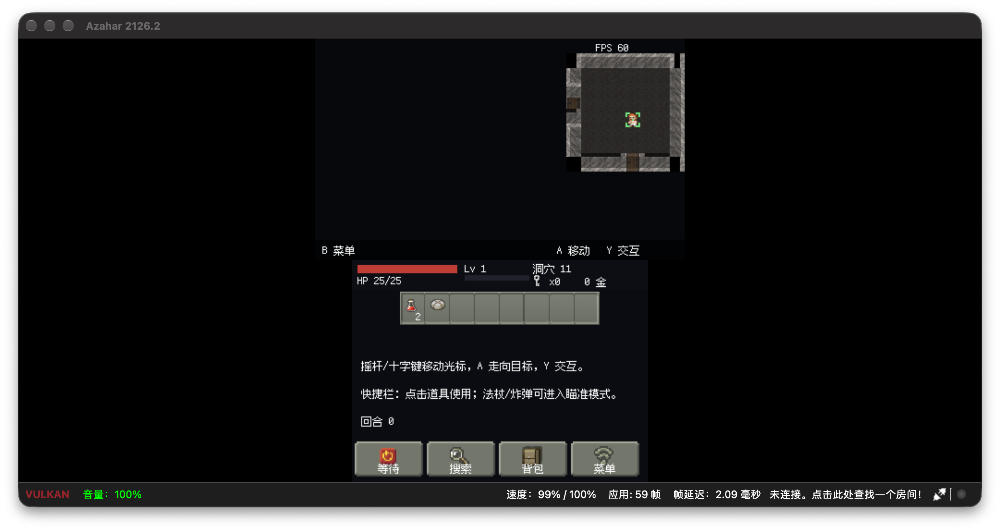

# Shattered Pixel Dungeon — Nintendo 3DS


A **native C++17 port** of [Shattered Pixel Dungeon](https://github.com/00-Evan/shattered-pixel-dungeon)
for the Nintendo 3DS, built with devkitARM, libctru and citro2d.

No JVM, no Dalvik, no APK wrapper, no Java-to-C++ transpiler: game logic, rendering,
input, saves and the dungeon loop are reimplemented from scratch for the 3DS.

[中文简介](#中文简介) · [Screenshots](#screenshots) · [Build](#building) · [Controls](#controls) · [Roadmap](#roadmap)

> **Status: complete 25-floor run, five regions, full save/load.** All five SPD
> regions are playable from floor 1 to Yog-Dzewa on floor 25, with region mobs,
> bosses, NPCs, shops, interactables and area events. Content breadth is still smaller
> than upstream SPD — see [Roadmap](#roadmap).

## 中文简介

这是 Shattered Pixel Dungeon 的 **3DS 原生 C++ 移植原型**：不运行 JVM、不运行 APK、
不用转译器。上下双屏菜单、6 英雄选择、**25 层 / 5 个区域**、回合制移动/战斗、
5 个 Boss、 NPC/商店/任务、装备与法杖、交互物、HUD、对话和**完整存档**都已跑通，
并且直接使用原版美术素材。

- 目标机型：Old 3DS / New 3DS（主要按 Old 3DS 的 400×240 + 320×240 设计）
- 开发环境：macOS + devkitPro（Linux 同样可用）
- 许可：GPL-3.0（与上游一致）

## Screenshots

| Title | Hero select |
| --- | --- |
|  |  |
| **Save slots** | **In-game dual screen** |
|  |  |
| **NPC dialog (top screen)** | **Backpack (SPD-style grid)** |
|  |  |
| **Item details / actions** | **Bag tabs (药水 filter)** |
|  |  |
| **Alchemy** | **Shop** |
|  |  |
| **Prison (6–10)** | **Caves (11–15)** |
|  |  |
| **City (16–20)** | **Halls boss (21–25)** |
|  |  |

## Features

### Front-end

- **Title**: original logo, parallax background that continues across both screens,
  three buttons (`进入地牢` / `排行榜` / `设置`) with a yellow corner cursor,
  D-pad / Circle Pad / touch input.
- **Local rankings**: top scores written to `sdmc:/3ds/spd/scores.bin`.
- **Settings**: tabbed UI on the bottom screen, title logo kept on top, back button,
  values persisted to `sdmc:/3ds/spd/settings.bin`.
- **Save slots**: 2×2 layout — three slots + `新游戏`, with hero icon, depth, level,
  HP bar and score.
- **Hero select**: splash art on top, name + `i` info button + 2×3 portrait grid on
  the bottom; the info popup shows title and description; tap the selected hero twice
  to start.

### Dungeon (25 floors / 5 regions)

| Floors | Region | Boss | Area events |
| --- | --- | --- | --- |
| 1–5 | 下水道 | 史莱姆王 | 幽魂护符任务、商店（2 层） |
| 6–10 | 监狱 | 天狗 | 上锁宝箱（需要钥匙）、商店（7 层） |
| 11–15 | 洞穴 | DM-300 | 铁匠强化装备（12 层）、商店（12 层） |
| 16–20 | 矮人城 | 矮人国王 | 小鬼徽记任务（16–19 层）、商店（17 层） |
| 21–25 | 恶魔大厅 | 尤格-泽瓦 | 最终 Boss、通关结算、商店（22 层） |

- Region-specific tilesets (`tiles_sewers/prison/caves/city/halls`), room-and-corridor
  generation, doors, secret doors, stairs, water/grass, and boss-gated stairs.
- **18 regular mob types** across the five regions (rats/gnolls/crabs, skeletons/
  thieves/guards, bats/brutes/shamans/spiders, golems/monks/warlocks, demons/eyes/
  rippers/wraiths), each with idle/run animation and smooth movement.
- **Bosses**: 史莱姆王, 天狗, DM-300, 矮人国王, 尤格-泽瓦 — unique sprites, boss HP bar,
  locked stairs until defeated, tier+1 equipment drops.
- **NPCs**: 幽魂 (amulet quest), 店主 (per-region shop), 铁匠 (pay 40 gold for a weapon
  upgrade), 小鬼 (collect 3 tokens on floors 16–19 for a reward).
- **Interactables / decorations**: chests, locked chests, wells, bookshelves, alchemy
  pots, statues, tombs, plants, signs, barricades, hidden traps and quest tokens.
  Search reveals traps and secret doors with SPD's blue `CheckedCell` pulse.
- **Shops**: 3–4 stocked items per region (potions, food, tiered gear, wands) with
  gold prices, sold-out state and touch/keyboard buying.
- **90 item definitions**: 15 weapons (tiers 1–5), 6 armor tiers, 13 wands,
  11 potions, 11 scrolls, 8 rings, 3 food types, 3 bombs, 3 throwing weapons,
  3 seeds, keys/gold/quest items.
- **Rings** with two equipment slots: might, accuracy, evasion, haste, wealth,
  energy, force and elements, each with passive combat/economy effects.
- **Scroll of Transmutation** now opens an inventory selector and changes the
  chosen item into a random item of the same category (weapon tier is preserved),
  instead of rolling a random inventory item.
- **Status effects**: haste, invisibility, levitation, mind vision, might, rage,
  sleep and terror are applied by potions, scrolls, wands, seeds and bombs.
- **Wands**: 13 types (single-target, AoE, beam, root, knockback, shield, heal,
  lifesteal, prismatic) with charges, recharge and per-wand behaviour.
- **Search** reproduces SPD's visual: per-tile blue square shrinking with distance
  delay, hero `operate` animation and a floating “搜索中” label.
- **SPD-style backpack**: 5×5 (25-slot) grid, gold/capacity, equipped gear, item
  badges, bag tabs (全部/药水/卷轴/法杖/装备/其他), and a detail panel with
  **使用 / 装备 / 瞄准 / 丢弃 / 关闭**.
- **Targeting mode** for bombs and wands; quick slots show counts/charges.
- Bottom HUD: HP/shield, level/XP, region + floor, keys, gold, 2×4 quick slots,
  wait/search/backpack/pause; search/wait long-press behaves like SPD.
- ABXY dialog overlay with NPC portrait, name, text and four key actions.
- Floor 25 victory screen after Yog-Dzewa.

### Loot generation (ported from SPD)

- Normal floors roll **3 / 4 / 5 items** at **60% / 30% / 10%**, plus one guaranteed
  food drop (`Level.createItems()`).
- Category weights follow SPD's combined generator deck: weapons 4, armor 3,
  thrown/bombs 5, wands 4, potions 16, scrolls 16, food 2, gold 20, keys 1,
  rings 2, throwing weapons 3, seeds 2.
- Item tiers use SPD's per-floor-set table
  `{0,75,20,4,1} / {0,25,50,20,5} / {0,0,40,50,10} / {0,0,20,40,40} / {0,0,0,20,80}`,
  so early floors mostly drop tier 2 and late floors tier 4–5.
- Heap presentation: 1/20 skeleton, 5/20 chest, otherwise a floor heap; upgradable
  items have a chance to become a **locked chest with a key** placed elsewhere.
- Gold piles use SPD's range `30 + 10×depth … 60 + 20×depth`.
- Mob drops are rare gold only (10%); bosses drop tier+1 equipment and a large purse.

### Shops (ported from SPD)

- Shops spawn on **depths 6, 11, 16 and 20**. The floor-20 shop is run by the
  Ambitious Imp and only appears if his quest has been completed.
- Stock follows SPD's category list: current-tier melee weapon, matching armor,
  a stack of throwing weapons, a healing potion + 2 random potions, magic mapping /
  identify / remove curse + a random scroll, 2 rations, a bomb, an Ankh, and a
  30% chance of a wand or ring.
- Prices use SPD's formula `value × quantity × 5 × (depth/5 + 1)` — 10× value in
  the first shop, 15× in the second, 20× in the third and 25× in the last.
- Selling gives `value × quantity × (depth/5 + 1) / 2` (about 1/10 of the buy
  price) and the last **3 sold items** can be bought back at the same price.
- Shop UI has 购买 / 出售 / 回购 tabs, 6 rows per page, **X** switches tabs,
  **L/R** pages, **A** trades and **B** closes.
- Shopkeeper warn/flee is implemented: damaging or debuffing him warns once,
  the second offense makes him vanish with all wares (saved per floor).
- Bag stock: Potion Bandolier / Scroll Holder / Magical Holster, each +5 slots;
  also sells an Ankh, Stone of Augmentation and tipped darts.

### NPC quests (ported from SPD)

| NPC | Floors | Task | Reward |
| --- | --- | --- | --- |
| Sad Ghost | 2–4 | Kill the floor's quest miniboss (Fetid Rat / Gnoll Trickster / Great Crab) | Choose a weapon or armor (tier 2–5, upgrade 0–3) |
| Old Wandmaker | 6–9 | Retrieve corpse dust from behind barricades | Choose one of two wands (+1…+3) |
| Troll Blacksmith | 11–14 | Collect 15 dark gold ore | Upgrade weapon or armor by +1 |
| Ambitious Imp | 17–19 | Kill 5 monks or 4 golems | +2 ring, unlocks the depth-20 shop |

Quest floors are rolled per run and stored in the save. Quest items are
non-sellable; the ghost disappears after the reward, and the Imp reappears as the
floor-20 shopkeeper. Picking up corpse dust spawns wraiths every few turns until
the Wandmaker is paid; the Blacksmith lends a pickaxe and seals a mine area behind
breakable barricades (implemented as a room on the same floor, not a separate
sub-level).

### Sources

Implementation was cross-checked against:

- [Shopkeeper (Pixel Dungeon Wiki)](https://pixeldungeon.fandom.com/wiki/Shopkeeper)
- [Special Rooms / Shop](https://pixeldungeon.fandom.com/wiki/Shattered_Pixel_Dungeon/Special_Rooms)
- [Shop (Pixel Dungeon Wiki)](https://pixeldungeon.wiki/Shop)
- [NPCs and Quests](https://pixeldungeon.fandom.com/wiki/Shattered_Pixel_Dungeon/Quests)
- [Quest](https://pixeldungeon.fandom.com/wiki/Quest)
- [Sad Ghost](https://pixeldungeon.fandom.com/wiki/Sad_ghost)

### Saves

Each slot is a versioned binary snapshot (~5 KB, format v9): seed/RNG, floor, player stats,
inventory, equipped weapon/armor, wand charges, map tiles, explored tiles, mobs,
floor items (including gold amounts and chest contents), features/traps, shop stock
and sold flags, per-region boss flags, quest tokens and the full 25-slot bag. Load restores the exact
run; leaving the game auto-saves. Slot files from older save formats are detected and
ignored safely (delete `sdmc:/3ds/spd/slot*.bin` after upgrading if needed).

## Controls

| Context | Input |
| --- | --- |
| Menus | D-pad / Circle Pad move, **A** confirm, **B** back, bottom-screen touch supported |
| Settings | ← → switch tab, ↑ ↓ select, **A** change value |
| Hero select | **A** select, **A** again on the same hero to start, **X** info popup |
| Game cursor | D-pad / Circle Pad (hold to repeat), **A** walk to tile, **Y** interact |
| Game actions | **B** pause menu (exit via the menu), **X** backpack, **L** wait, **R** search, **START** pause |
| Targeting | **A** cast/throw at cursor, **B** cancel |
| Backpack | **L/R** switch tab (全部/药水/卷轴/法杖/装备/其他), D-pad select, **A** details, **A** use/equip/aim, **X** drop, **B** close; tabs and slots are touchable |
| Dialog | **A / B / X / Y** pick the matching option |

## Building

### Requirements

- devkitPro `3ds-dev` (devkitARM r68+, libctru 2.7+, citro2d 1.7+)
- `make`, `git`, `ffmpeg`, Python 3 with `venv`
- A clone of the upstream assets (GPL-3.0)

### Steps

```bash
git clone https://github.com/YurizonoMika/Shattered-Pixel-Dungeon-3DS.git
cd Shattered-Pixel-Dungeon-3DS

# 1. Upstream assets (only core assets are needed)
git clone --depth 1 https://github.com/00-Evan/shattered-pixel-dungeon.git ../spd-upstream
bash tools/prepare-assets.sh          # copy PNGs + hero art, generate .t3s

# 2. CJK bitmap font (OFL, pinned SHA-256)
bash tools/fetch-fonts.sh
python3 -m venv tools/venv
tools/venv/bin/pip install pillow fonttools
tools/venv/bin/python tools/gen_font.py

# 3. Build
export DEVKITPRO=/opt/devkitpro
export DEVKITARM=$DEVKITPRO/devkitARM
export PATH=$DEVKITPRO/tools/bin:$DEVKITARM/bin:$PATH
make
```

The build produces `spd3ds.3dsx` (~2.1 MB). Textures are packed into the RomFS at
build time by `tex3ds`; nothing is loaded from the SD card except saves/settings.

Tested against upstream commit
[`57a4e06`](https://github.com/00-Evan/shattered-pixel-dungeon/commit/57a4e06a4caf162446d1c28caa7983f0493fecf0).

### Running

```bash
# Azahar (Citra fork) — windowed
open -a "$HOME/Applications/Azahar.app" "$PWD/spd3ds.3dsx"

# Real hardware (Homebrew Launcher with NetLoader)
3dslink spd3ds.3dsx
```

> If Azahar's default window is too short, maximize it or use fullscreen; the bottom
> screen's last few pixels can be clipped by the window size.

### Troubleshooting

| Symptom | Fix |
| --- | --- |
| Black screens / `[assets] missing romfs:/gfx/...` | Run `tools/prepare-assets.sh` and `make` again |
| Chinese glyphs show as boxes | New strings were added → rerun `tools/gen_font.py` |
| `DEVKITARM` is not set | `source setup/env.sh` from the 3ds-dev workspace, or export it manually |
| `sha256` command not found | macOS: `shasum`; Linux: install `coreutils` / use `sha256sum` |

## Architecture

```text
source/
├── main.cpp          # boot, input, scene state machine, menus/settings/saves/heroes
├── game_screen.cpp   # in-game top/bottom rendering, HUD, dialogs, backpack, pause
├── game.cpp          # level generation, FOV, turn loop, AI, items, save metadata
├── assets.cpp        # texture loading, 9-patch, grid slicing, bitmap text
├── common.h / app.h  # shared state and drawing/input interfaces
└── font_glyphs.h     # generated by tools/gen_font.py
gfx/                  # upstream PNGs + tex3ds descriptors
romfs/gfx/            # generated .t3x textures embedded by 3dsxtool
tools/                # asset prep, font generation, dev helpers
```

- Two `C2D_RenderTarget`s (top 400×240, bottom 320×240) are drawn every frame.
- `C3D_DepthTest(true, GPU_ALWAYS, ...)` keeps strict submission order for 2D UI.
- All textures use `GPU_NEAREST` filtering to preserve pixel art.
- Character frames follow SPD's sheets (hero/gnoll 12×15, rat 16×15, crab 16×16)
  with the same idle/run frame tables, drawn with SPD's tile-relative offsets.
- Player movement is a queued BFS path: one tile per turn, with a short visual
  interpolation, so turns stay deterministic while sprites move smoothly.
- Text is a generated white-alpha glyph atlas tinted at runtime with `C2D_TintMult`.
- Saves use a fixed-size `GameDisk` struct (`source/game.h`) with magic + version
  fields; `Game::slot_meta` reads just the header for the slot list.

### Asset pipeline

1. `tools/prepare-assets.sh` copies the sheets we need and converts hero splash JPGs
   to 400px-wide PNGs.
2. Each PNG gets a one-line `.t3s`; `tex3ds` turns it into a `.t3x` in `romfs/gfx/`.
3. The runtime slices grid sheets with UVs derived from SPD's `xy(col,row)` layout
   (`FLOOR=0`, `EXIT=17`, `WATER=32`, `FLAT_WALL=48`, `FLAT_DOOR=56`).
4. 9-patch insets come from SPD's `Chrome.java` (`WINDOW`, `GREY_BUTTON`, tabs).

### Font pipeline

`tools/gen_font.py` scans `source/*.cpp` and `source/*.h` for every non-ASCII
character, renders it with **Fusion Pixel 12px** (OFL), packs a 512×N atlas and emits
`source/font_glyphs.h` (codepoint → rect + metrics). Add UI text → rerun the script.
Only the glyphs actually used are included, keeping the atlas small.

Readability rules used by the renderer:

- only **integer scales** (1× body, 2× headings) — fractional downscaling with
  `GPU_NEAREST` drops pixel rows and makes CJK look broken;
- every glyph is snapped to the integer pixel grid;
- a 1 px dark shadow (2 px at 2×) is drawn behind text so it stays readable on the
  dungeon background and on 9-patch panels;
- body text uses high-contrast near-white instead of mid-grey.

## Debug

Drop `sdmc:/3ds/spd/scene.txt` (Azahar:
`~/Library/Application Support/Azahar/sdmc/3ds/spd/scene.txt`) and relaunch:

| Value | Scene |
| --- | --- |
| 1 | Rankings |
| 2 | Settings |
| 3 | Save slots |
| 4 | Hero select |
| 5 | New game |
| 10 | Game + NPC dialog |
| 11 | Game + backpack |
| 12 | Game + pause |
| 13 | Game + targeting |
| 14 | Hero select + info popup |
| 15 | Game with starter gear/wands/bombs |
| 16 | Same as 15 + backpack open |
| 17 | Same as 15 + wand targeting |
| 18 | Floor 3 next to the boss |
| 19 | Floor 2 next to the quest amulet |
| 21 | Frozen mid-walk pose (animation check) |
| 22 | Frozen search effect (CheckedCell + operate pose) |
| 23 | Backpack with the item-detail panel open |
| 24 | Backpack on the 药水 tab (filter demo) |
| 25–29 | Boss floors 5 / 10 / 15 / 20 / 25 |
| 30 | Prison (floor 6) |
| 31 | Caves (floor 11) |
| 32 | City (floor 16) |
| 33 | Halls (floor 21) |
| 34 | Blacksmith dialog (floor 12) |
| 35 | Imp quest dialog (floor 17) |
| 36 | Shop UI (floor 6) |
| 54 | Shop UI (floor 6, fresh run) |
| 55–58 | Ghost / Wandmaker / Blacksmith / Imp dialogs |
| 59 | Floor-20 Imp shop |
| 60 | Ghost quest accepted (miniboss spawned) |
| 61 | Ghost reward choice |
| 62–64 | Wandmaker / Blacksmith / Imp quest accepted |
| 65 | Generate all 25 floors (smoke test) |
| 70 | Alchemy UI |
| 72 | Scroll of Transmutation item selector |
| 71 | Pause menu with talent progress |
| 40 | Backpack with rings/missiles/seeds |
| 41 | Ring detail panel |

The app appends boot/scene-boot diagnostics to `log.txt` in the same folder, which is
useful when the emulator shows an exception dialog.

## Roadmap

- [x] Dual-screen shell, settings, saves, hero select
- [x] Dungeon generation, FOV, turn loop, mobs, items, HUD
- [x] CJK bitmap font pipeline
- [x] Full save/load (map, mobs, inventory, equipment, quest/boss state)
- [x] All 25 floors and 5 regions with region mobs, bosses, NPCs, shops,
      interactables and area events
- [x] Full item table across all categories (weapons/armor/wands/potions/
      scrolls/rings/bombs/missiles/seeds) with gameplay effects
- [x] Shopkeeper warn/flee, bags, alchemy UI, Stone of Augmentation, tipped darts
- [x] Wandmaker wraith spawns, pickaxe/ore mine area, class-neutral talent tiers
- [ ] True Old Mine sub-level (currently a sealed room on the same floor)
- [ ] Full class-specific 3-way talent trees (currently 4 fixed talent tiers)
- [ ] Difficulty tuning across all 25 floors
- [ ] Audio: `ndsp` or SDL2_mixer (library already built for 3DS)
- [ ] CIA packaging (makerom/bannertool, banner + icon, RSF permissions)
- [ ] Old 3DS performance and memory tuning
- [ ] GitHub Actions build (devkitPro container)

## Credits

- **Shattered Pixel Dungeon** by Evan Debenham and contributors — game design and
  all art/audio assets (GPL-3.0).
- **devkitPro** — devkitARM, libctru, citro2d, tex3ds.
- **Fusion Pixel Font** by TakWolf — OFL-1.1.
- **Azahar** — 3DS emulator used for testing.

This project is not affiliated with Nintendo or with the Shattered Pixel Dungeon
team. Only port code in this repository is original to this project.

## License

GPL-3.0, matching upstream. See [LICENSE](LICENSE).

Assets copied from the upstream game remain GPL-3.0; do not redistribute them
separately from a GPL-compatible work.
