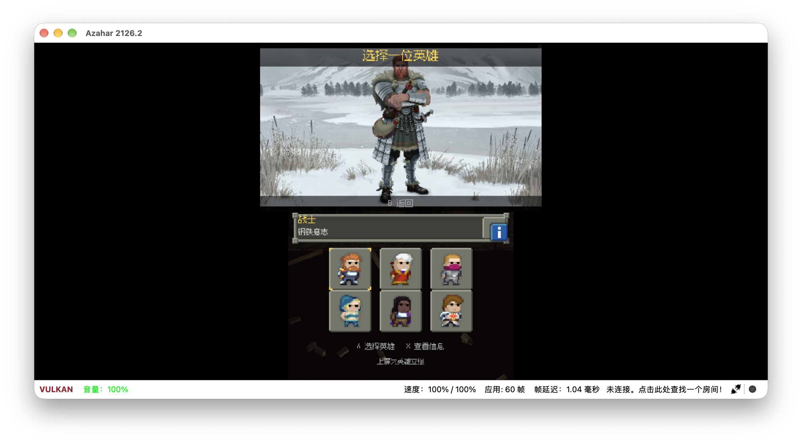
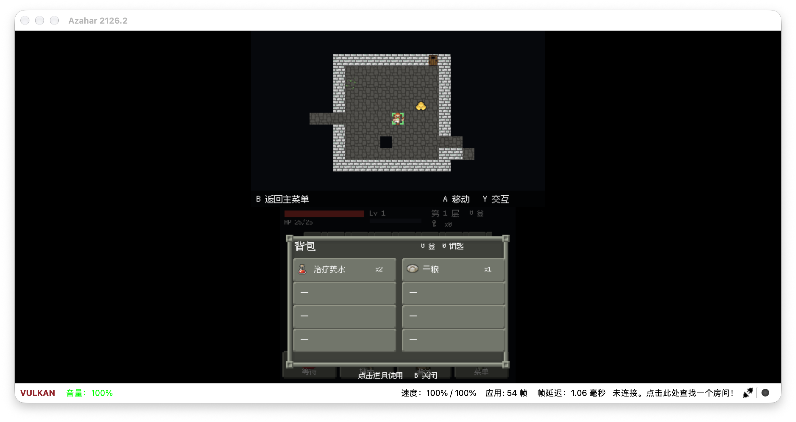

# Shattered Pixel Dungeon — Nintendo 3DS（C++ 重写）

这是 [Shattered Pixel Dungeon](https://github.com/00-Evan/shattered-pixel-dungeon)
的 **3DS 原生 C++ 移植原型**。它不运行 JVM、不运行 APK、不用转译器：游戏逻辑、
渲染、输入、存档全部用 C++17 + libctru/citro2d 重新实现。

> 这是一个**可运行的纵切片（vertical slice）**，不是完整游戏。
> 双屏菜单、选英雄、地牢生成、回合制移动/战斗、HUD、道具、存档都已可玩；
> 但 SPD 的完整内容（25 层、6 职业天赋树、数百种物品/怪物、任务、商店）尚未移植。
> 详见文末「移植范围」。

## 截图

| 主菜单 | 选择英雄 |
| --- | --- |
|  |  |
| **进行中的游戏** | **游戏内双屏** |
|  |  |
| **NPC 对话（上屏）** | **背包（下屏）** |
|  |  |

## 构建

前提：已按 `~/Documents/3ds-dev/README.md` 配好 devkitPro 3DS 工具链。

```bash
cd ~/Documents/3ds-dev/projects/shattered-pixel-dungeon

# 1. 素材：从上游仓库复制并转换（只需要一次）
git clone --depth 1 https://github.com/00-Evan/shattered-pixel-dungeon.git ../spd-upstream
bash tools/prepare-assets.sh

# 2. 中文字库：扫描 source/ 里用到的字符，生成 512px 字库图集
bash tools/fetch-fonts.sh          # 下载并校验 OFL 字体
python3 -m venv tools/venv
tools/venv/bin/pip install pillow fonttools
tools/venv/bin/python tools/gen_font.py

# 3. 编译
source ~/Documents/3ds-dev/setup/env.sh
make
```

产物：`spd3ds.3dsx`（约 2.1 MB，RomFS 内含全部纹理）。

运行：

```bash
open -a "$HOME/Applications/Azahar.app" "$PWD/spd3ds.3dsx"
# 真机（Homebrew Launcher 已开 NetLoader）：
3dslink spd3ds.3dsx
```

## 操作

### 主菜单

- 上屏：原版 LOGO + 上下屏连续的视差背景。
- 下屏：`进入地牢` / `排行榜` / `设置`，十字键/摇杆移动黄色光标，A 确认，也可直接触摸。
- 排行榜是**本地**记录（死亡或放弃时写入 `sdmc:/3ds/spd/scores.bin`）。

### 设置

- 上屏保持 LOGO，下屏是标签页 + 设置项，`返回` 按钮回主菜单。
- 三个标签：游戏 / 音频 / 画面。左右切换标签，上下选项，A 修改，触摸可用。
- 设置写入 `sdmc:/3ds/spd/settings.bin`。

### 进行中的游戏

- 上屏：`进行中的游戏` + 图标 + `B 返回主菜单`。
- 下屏：2×2 布局，3 个存档位 + `新游戏`。
- 有存档按 A 直接进入；空位/新游戏进入选英雄。

### 选择英雄

- 上屏：当前英雄立绘（上游 `splashes/*.jpg`），顶部 `选择一位英雄`，底部 `B 返回`。
- 下屏：英雄名称 + `i` 信息按钮 + 2×3 头像网格。
- 点 `i`（或 X）在上屏弹出英雄信息浮窗，再点一次关闭。
- 第一次点/按 A 选中英雄，**再次点同一英雄**才开始新游戏。

### 游戏内

上屏：

- 地牢地图、角色、怪物、物品、绿色/黄色地块光标。
- 底部提示：`B 返回主菜单`、`A 移动`、`Y 交互`。

下屏：

- 状态栏：血量、等级/经验、楼层、钥匙、金币。
- 2×4 快捷栏：点击道具使用（药水回血、卷轴揭图、炸弹进入投掷模式）。
- 四个按钮：等待 / 搜索 / 背包 / 菜单。
  - 等待：点一次等一回合；**长按持续等待，掉血后自动停止**。
  - 搜索：发现 3 格内的暗门。
  - 背包：下屏打开背包，点击道具使用，B 关闭。
  - 菜单：暂停菜单（继续 / 设置 / 返回主菜单）。
- 光标：摇杆/十字键逐格移动（按住连续移动），A 走向目标（BFS 自动寻路），
  Y 与目标交互（攻击、拾取、开箱/暗门、下楼梯）。
- 投掷模式：光标变黄，A 投掷到目标格，B 取消。
- 对话：显示在上屏，左侧 NPC 头像/名字/正文，右侧 1/4 是 A/B/X/Y 四个操作按钮。

## 代码结构

```text
source/
├── main.cpp          # 启动、输入、场景状态机、菜单/设置/存档/选英雄
├── game_screen.cpp   # 游戏内上下屏渲染与输入（光标/HUD/弹窗/背包）
├── game.cpp          # 地牢生成、FOV、回合制、怪物 AI、道具、存档元数据
├── assets.cpp        # 纹理加载、9-patch、网格切片、中文位图文字
├── common.h / app.h  # 全局状态、绘制/输入接口
└── font_glyphs.h     # 由 tools/gen_font.py 生成
gfx/                  # 从上游复制的 PNG + tex3ds 描述
romfs/gfx/            # 构建期生成的 .t3x（RomFS）
tools/
├── prepare-assets.sh # 素材复制/转码（需要 ../spd-upstream）
├── gen_font.py       # 中文位图字体生成（Fusion Pixel 12px, OFL）
└── winid/            # 开发辅助：取 Azahar 窗口 ID（配合 screencapture）
```

## 素材与渲染说明

- 图块、道具、英雄、棋子都来自上游 `core/src/main/assets`，网格切片在运行时
  按 SPD 的 `xy(col,row)` 规则取子矩形。
- 地块索引取自 `DungeonTileSheet`（FLOOR=0、EXIT=17、WATER=32、FLAT_WALL=48、
  FLAT_DOOR=56），所以画面与原版一致。
- 9-patch 使用 `Chrome.java` 的切分参数（WINDOW、GREY_BUTTON 等）。
- 中文文字是构建期生成的白色 alpha 图集，运行时用 `C2D_TintMult` 着色。

## 调试

在 `sdmc:/3ds/spd/`（Azahar 对应
`~/Library/Application Support/Azahar/sdmc/3ds/spd/`）放一个 `scene.txt`，
启动时读取后删除：

| 值 | 场景 |
| --- | --- |
| 1 | 排行榜 |
| 2 | 设置 |
| 3 | 存档 |
| 4 | 选英雄 |
| 5 | 直接开始游戏 |
| 10 | 游戏 + NPC 对话 |
| 11 | 游戏 + 背包 |
| 12 | 游戏 + 暂停 |
| 13 | 游戏 + 投掷模式 |
| 14 | 选英雄 + 信息浮窗 |

启动/场景切换会写 `log.txt`，崩溃时用它定位最后阶段。

## 移植范围

已实现：

- 双屏主菜单、设置（3 标签 × 10 项）、本地排行榜、3 存档位、6 英雄选择与信息浮窗
- 房间+走廊地牢生成、门/暗门/楼梯/水/草、BFS 寻路、逐格光标、回合制
- 视野（Bresenham LOS）、两种怪物 + 友好 NPC、近战/投掷、升级、掉落与拾取
- HUD、2×4 快捷栏、等待长按、搜索、背包、暂停、A/B/X/Y 对话选项
- 存档元数据（职业、层数、血量、等级、金币、种子、回合数）

尚未实现（按优先级）：

1. **完整游戏内容**：SPD 的 25 层、Boss、6 职业天赋树、数百物品/怪物/法术、商店、任务
2. **音频**：`ndsp` 或 SDL2_mixer（库已装好），BGM/音效
3. **完整存档**：地图、背包、任务状态；当前按种子重建布局，只保存元数据
4. **CIA 打包**：makerom/bannertool、banner/icon、RSF 权限
5. **真机性能与内存**：Old 3DS 帧率、贴图内存、休眠恢复
6. **本地化**：字库只包含源码扫描到的字符，新增文本后必须重跑 `gen_font.py`

> 客观规模：SPD 的 Java 代码约 20 万行，包含大量数据驱动内容。
> 本仓库证明的是「3DS 双屏交互 + 原生 C++ 管线」可行，并把前端与核心循环跑通；
> 要做到 1:1 完整移植，需要按系统（物品、怪物、法术、天赋、任务）持续填充。

## 许可

- 代码：GPL-3.0（与上游一致）。
- 美术/音频素材：来自上游 Shattered Pixel Dungeon，GPL-3.0；请勿单独分发商业素材。
- 字体：Fusion Pixel Font（SIL Open Font License 1.1），见 `tools/fonts/OFL.txt`。
