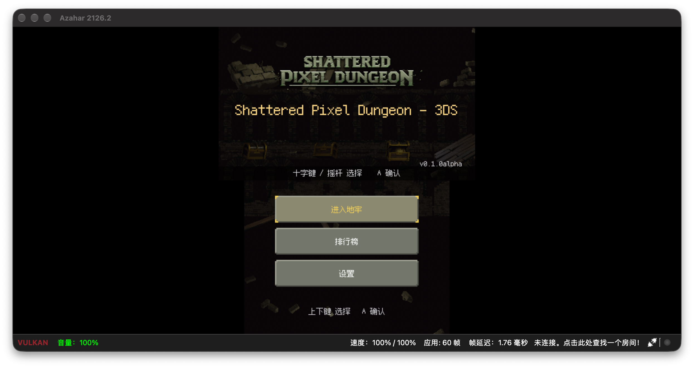
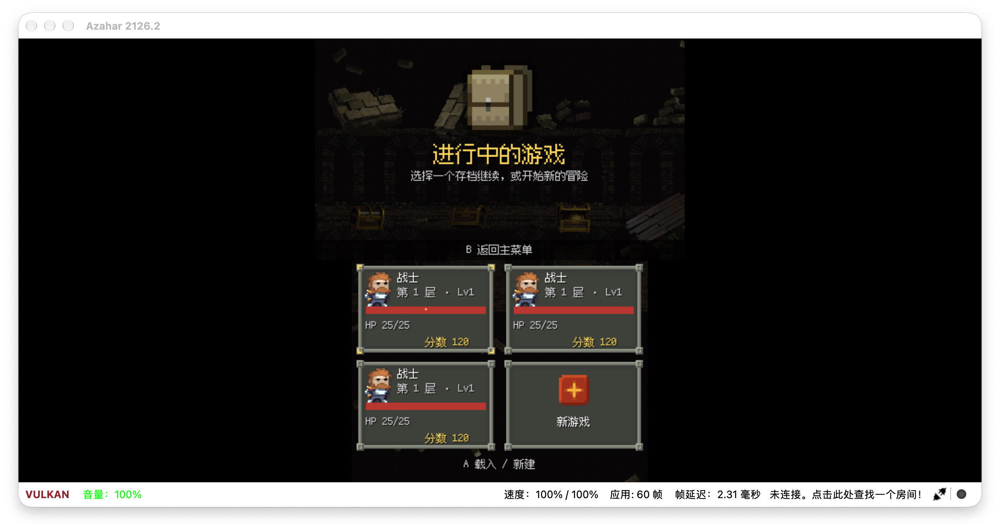
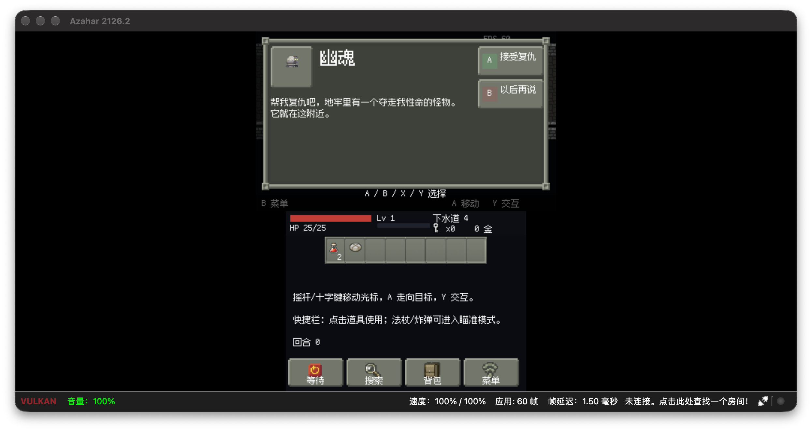
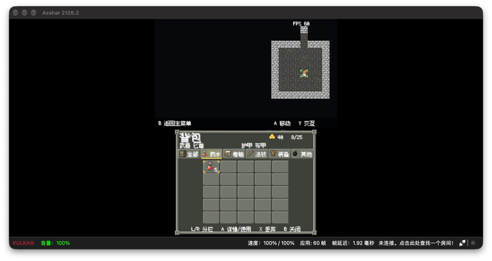
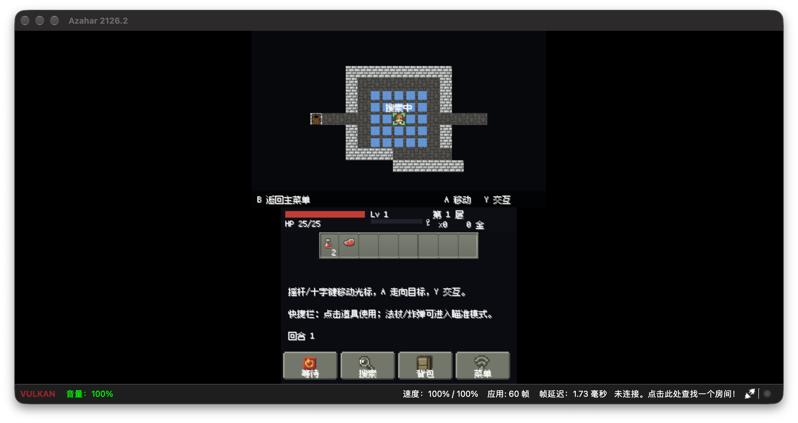

# Shattered Pixel Dungeon — Nintendo 3DS


A **native C++17 port** of [Shattered Pixel Dungeon](https://github.com/00-Evan/shattered-pixel-dungeon)
for the Nintendo 3DS, built with devkitARM, libctru and citro2d.

No JVM, no Dalvik, no APK wrapper, no Java-to-C++ transpiler: game logic, rendering,
input, saves and the dungeon loop are reimplemented from scratch for the 3DS.

[中文简介](#中文简介) · [Screenshots](#screenshots) · [Build](#building) · [Controls](#controls) · [Roadmap](#roadmap)

> **Status: playable 3-floor slice, full save/load.** The dual-screen shell, hero
> select, dungeon generation, turn loop, equipment, wands, a floor-3 boss and complete
> run snapshots are working. It is not yet the full 25-floor game — see
> [Roadmap](#roadmap).

## 中文简介

这是 Shattered Pixel Dungeon 的 **3DS 原生 C++ 移植原型**：不运行 JVM、不运行 APK、
不用转译器。上下双屏菜单、6 英雄选择、前三层地牢、回合制移动/战斗、装备/法杖/
消耗品、Boss、任务 NPC、HUD、对话和**完整存档**都已跑通，并且直接使用原版美术素材。

- 目标机型：Old 3DS / New 3DS（主要按 Old 3DS 的 400×240 + 320×240 设计）
- 开发环境：macOS + devkitPro（Linux 同样可用）
- 许可：GPL-3.0（与上游一致）

## Screenshots

| Title | Hero select |
| --- | --- |
|  |  |
| **Save slots** | **In-game dual screen** |
|  |  |
| **NPC dialog (top screen)** | **Backpack (SPD-style grid)** |
|  |  |
| **Item details / actions** | **Bag tabs (药水 filter)** |
|  |  |
| **Search effect (CheckedCell pulse)** | |
|  | |

## Features

### Front-end

- **Title**: original logo, parallax background that continues across both screens,
  three buttons (`进入地牢` / `排行榜` / `设置`) with a yellow corner cursor,
  D-pad / Circle Pad / touch input.
- **Local rankings**: top scores written to `sdmc:/3ds/spd/scores.bin`.
- **Settings**: tabbed UI on the bottom screen, title logo kept on top, back button,
  values persisted to `sdmc:/3ds/spd/settings.bin`.
- **Save slots**: 2×2 layout — three slots + `新游戏`, with hero icon, depth, level,
  HP bar and score.
- **Hero select**: splash art on top, name + `i` info button + 2×3 portrait grid on
  the bottom; the info popup shows title and description; tap the selected hero twice
  to start.

### Dungeon (floors 1–3)

- Room-and-corridor generation, doors, secret doors, stairs, water and grass.
- Bresenham line-of-sight, explored/fogged tiles, camera follows the player/cursor.
- Turn-based movement: cursor moves tile-by-tile, **A** auto-walks (BFS), **Y**
  interacts (attack / pick up / open secret door / descend).
- Mobs: giant rat, gnoll, sewer crab, albino rat; a **floor-3 boss** guards the exit,
  and a friendly ghost NPC gives a quest.
- Sprite animation: idle and run cycles for the hero, every mob and the NPC, plus
  smooth per-tile movement interpolation for the player and monsters.
- Orientation-aware doors (the flat door sprite is rotated to match the wall) and
  floating/bobbing floor items with small shadows.
- **Search** reproduces SPD's visual: every searched tile gets the blue
  `CheckedCell` square that shrinks and fades with a distance delay, the hero plays
  the `operate` animation, and a “搜索中” label floats above the head.
- Weapons and armor with upgrade levels, two wands with charges and recharging,
  bombs, three potions, mapping/upgrade/teleport scrolls, food, keys and gold.
- **SPD-style backpack**: a 5×5 (25-slot) grid with gold, capacity, equipped gear,
  item quantity/charge badges, a selection cursor, and a detail panel with
  name/description plus **使用 / 装备 / 丢弃 / 关闭** actions.
- **Bag tabs** like SPD's bag types: 全部 / 药水 / 卷轴 / 法杖 / 装备 / 其他,
  with item icons, **L/R** switching and direct touch on the tab bar.
- Quick slots show stack counts or wand charges; extra items live in the bag.
- **Targeting mode** for bombs and wands: cursor turns yellow, **A** uses, **B** cancels.
- Bottom HUD: HP/shield, level/XP, floor, keys, gold, 2×4 quick slots, and four
  actions: wait (**hold to keep waiting until HP drops**), search, backpack, pause menu.
- ABXY dialog overlay on the top screen: NPC portrait/name/text on the left, action
  buttons on the right.
- Floor 3 stairs end the slice with a score/victory screen.

### Saves

Each slot is a versioned binary snapshot (~5 KB, format v4): seed/RNG, floor, player stats,
inventory, equipped weapon/armor, wand charges, map tiles, explored tiles, mobs,
floor items, quest and boss flags, and the full 25-slot bag. Load restores the exact
run; leaving the game auto-saves. Slot files from older save formats are detected and
ignored safely (delete `sdmc:/3ds/spd/slot*.bin` after upgrading if needed).

## Controls

| Context | Input |
| --- | --- |
| Menus | D-pad / Circle Pad move, **A** confirm, **B** back, bottom-screen touch supported |
| Settings | ← → switch tab, ↑ ↓ select, **A** change value |
| Hero select | **A** select, **A** again on the same hero to start, **X** info popup |
| Game cursor | D-pad / Circle Pad (hold to repeat), **A** walk to tile, **Y** interact |
| Game actions | **B** back to save list (auto-save), **X** backpack, **L** wait, **R** search, **START** pause |
| Targeting | **A** cast/throw at cursor, **B** cancel |
| Backpack | **L/R** switch tab (全部/药水/卷轴/法杖/装备/其他), D-pad select, **A** details, **A** use/equip/aim, **X** drop, **B** close; tabs and slots are touchable |
| Dialog | **A / B / X / Y** pick the matching option |

## Building

### Requirements

- devkitPro `3ds-dev` (devkitARM r68+, libctru 2.7+, citro2d 1.7+)
- `make`, `git`, `ffmpeg`, Python 3 with `venv`
- A clone of the upstream assets (GPL-3.0)

### Steps

```bash
git clone https://github.com/YurizonoMika/Shattered-Pixel-Dungeon-3DS.git
cd Shattered-Pixel-Dungeon-3DS

# 1. Upstream assets (only core assets are needed)
git clone --depth 1 https://github.com/00-Evan/shattered-pixel-dungeon.git ../spd-upstream
bash tools/prepare-assets.sh          # copy PNGs + hero art, generate .t3s

# 2. CJK bitmap font (OFL, pinned SHA-256)
bash tools/fetch-fonts.sh
python3 -m venv tools/venv
tools/venv/bin/pip install pillow fonttools
tools/venv/bin/python tools/gen_font.py

# 3. Build
export DEVKITPRO=/opt/devkitpro
export DEVKITARM=$DEVKITPRO/devkitARM
export PATH=$DEVKITPRO/tools/bin:$DEVKITARM/bin:$PATH
make
```

The build produces `spd3ds.3dsx` (~2.1 MB). Textures are packed into the RomFS at
build time by `tex3ds`; nothing is loaded from the SD card except saves/settings.

Tested against upstream commit
[`57a4e06`](https://github.com/00-Evan/shattered-pixel-dungeon/commit/57a4e06a4caf162446d1c28caa7983f0493fecf0).

### Running

```bash
# Azahar (Citra fork) — windowed
open -a "$HOME/Applications/Azahar.app" "$PWD/spd3ds.3dsx"

# Real hardware (Homebrew Launcher with NetLoader)
3dslink spd3ds.3dsx
```

> If Azahar's default window is too short, maximize it or use fullscreen; the bottom
> screen's last few pixels can be clipped by the window size.

### Troubleshooting

| Symptom | Fix |
| --- | --- |
| Black screens / `[assets] missing romfs:/gfx/...` | Run `tools/prepare-assets.sh` and `make` again |
| Chinese glyphs show as boxes | New strings were added → rerun `tools/gen_font.py` |
| `DEVKITARM` is not set | `source setup/env.sh` from the 3ds-dev workspace, or export it manually |
| `sha256` command not found | macOS: `shasum`; Linux: install `coreutils` / use `sha256sum` |

## Architecture

```text
source/
├── main.cpp          # boot, input, scene state machine, menus/settings/saves/heroes
├── game_screen.cpp   # in-game top/bottom rendering, HUD, dialogs, backpack, pause
├── game.cpp          # level generation, FOV, turn loop, AI, items, save metadata
├── assets.cpp        # texture loading, 9-patch, grid slicing, bitmap text
├── common.h / app.h  # shared state and drawing/input interfaces
└── font_glyphs.h     # generated by tools/gen_font.py
gfx/                  # upstream PNGs + tex3ds descriptors
romfs/gfx/            # generated .t3x textures embedded by 3dsxtool
tools/                # asset prep, font generation, dev helpers
```

- Two `C2D_RenderTarget`s (top 400×240, bottom 320×240) are drawn every frame.
- `C3D_DepthTest(true, GPU_ALWAYS, ...)` keeps strict submission order for 2D UI.
- All textures use `GPU_NEAREST` filtering to preserve pixel art.
- Character frames follow SPD's sheets (hero/gnoll 12×15, rat 16×15, crab 16×16)
  with the same idle/run frame tables, drawn with SPD's tile-relative offsets.
- Player movement is a queued BFS path: one tile per turn, with a short visual
  interpolation, so turns stay deterministic while sprites move smoothly.
- Text is a generated white-alpha glyph atlas tinted at runtime with `C2D_TintMult`.
- Saves use a fixed-size `GameDisk` struct (`source/game.h`) with magic + version
  fields; `Game::slot_meta` reads just the header for the slot list.

### Asset pipeline

1. `tools/prepare-assets.sh` copies the sheets we need and converts hero splash JPGs
   to 400px-wide PNGs.
2. Each PNG gets a one-line `.t3s`; `tex3ds` turns it into a `.t3x` in `romfs/gfx/`.
3. The runtime slices grid sheets with UVs derived from SPD's `xy(col,row)` layout
   (`FLOOR=0`, `EXIT=17`, `WATER=32`, `FLAT_WALL=48`, `FLAT_DOOR=56`).
4. 9-patch insets come from SPD's `Chrome.java` (`WINDOW`, `GREY_BUTTON`, tabs).

### Font pipeline

`tools/gen_font.py` scans `source/*.cpp` and `source/*.h` for every non-ASCII
character, renders it with **Fusion Pixel 12px** (OFL), packs a 512×N atlas and emits
`source/font_glyphs.h` (codepoint → rect + metrics). Add UI text → rerun the script.
Only the glyphs actually used are included, keeping the atlas small.

Readability rules used by the renderer:

- only **integer scales** (1× body, 2× headings) — fractional downscaling with
  `GPU_NEAREST` drops pixel rows and makes CJK look broken;
- every glyph is snapped to the integer pixel grid;
- a 1 px dark shadow (2 px at 2×) is drawn behind text so it stays readable on the
  dungeon background and on 9-patch panels;
- body text uses high-contrast near-white instead of mid-grey.

## Debug

Drop `sdmc:/3ds/spd/scene.txt` (Azahar:
`~/Library/Application Support/Azahar/sdmc/3ds/spd/scene.txt`) and relaunch:

| Value | Scene |
| --- | --- |
| 1 | Rankings |
| 2 | Settings |
| 3 | Save slots |
| 4 | Hero select |
| 5 | New game |
| 10 | Game + NPC dialog |
| 11 | Game + backpack |
| 12 | Game + pause |
| 13 | Game + targeting |
| 14 | Hero select + info popup |
| 15 | Game with starter gear/wands/bombs |
| 16 | Same as 15 + backpack open |
| 17 | Same as 15 + wand targeting |
| 18 | Floor 3 next to the boss |
| 19 | Floor 2 next to the quest amulet |
| 21 | Frozen mid-walk pose (animation check) |
| 22 | Frozen search effect (CheckedCell + operate pose) |
| 23 | Backpack with the item-detail panel open |
| 24 | Backpack on the 药水 tab (filter demo) |

The app appends boot/scene-boot diagnostics to `log.txt` in the same folder, which is
useful when the emulator shows an exception dialog.

## Roadmap

- [x] Dual-screen shell, settings, saves, hero select
- [x] Dungeon generation, FOV, turn loop, mobs, items, HUD
- [x] CJK bitmap font pipeline
- [x] Full save/load (map, mobs, inventory, equipment, quest/boss state)
- [x] Floors 1–3 content: four mob types, floor-3 boss, gear, wands, potions,
      scrolls, quest NPC, victory screen
- [ ] Remaining floors 4–25, shops, talents, full item/mob/spell tables
- [ ] Audio: `ndsp` or SDL2_mixer (library already built for 3DS)
- [ ] CIA packaging (makerom/bannertool, banner + icon, RSF permissions)
- [ ] Old 3DS performance and memory tuning
- [ ] GitHub Actions build (devkitPro container)

## Credits

- **Shattered Pixel Dungeon** by Evan Debenham and contributors — game design and
  all art/audio assets (GPL-3.0).
- **devkitPro** — devkitARM, libctru, citro2d, tex3ds.
- **Fusion Pixel Font** by TakWolf — OFL-1.1.
- **Azahar** — 3DS emulator used for testing.

This project is not affiliated with Nintendo or with the Shattered Pixel Dungeon
team. Only port code in this repository is original to this project.

## License

GPL-3.0, matching upstream. See [LICENSE](LICENSE).

Assets copied from the upstream game remain GPL-3.0; do not redistribute them
separately from a GPL-compatible work.
