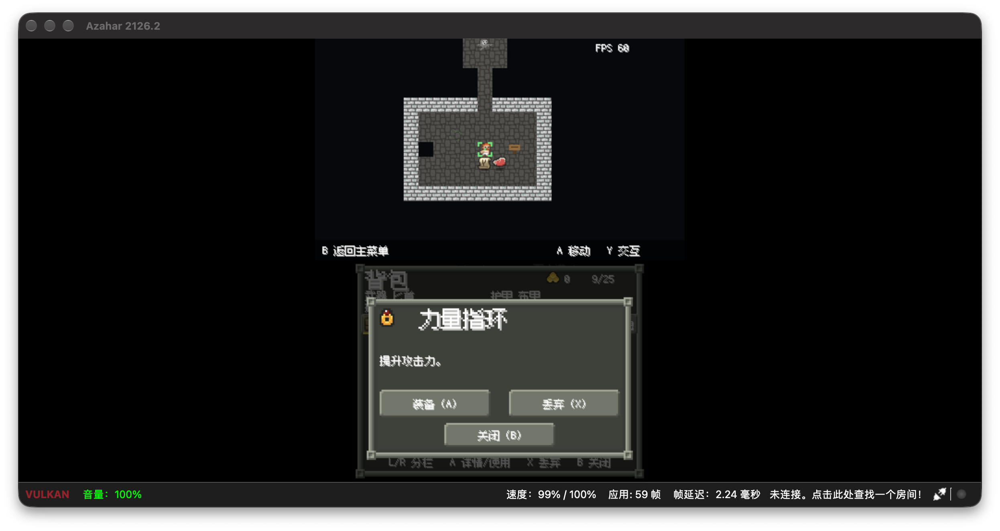
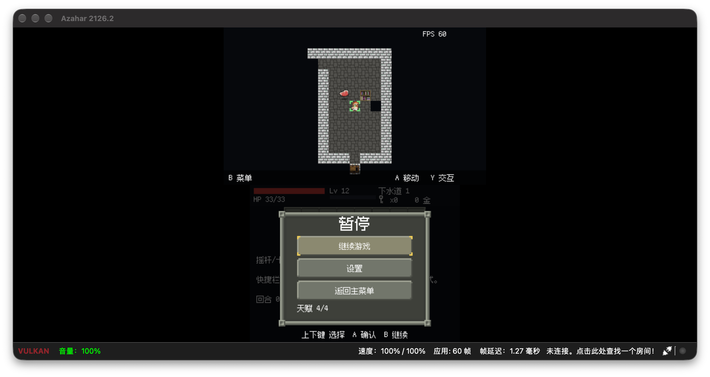
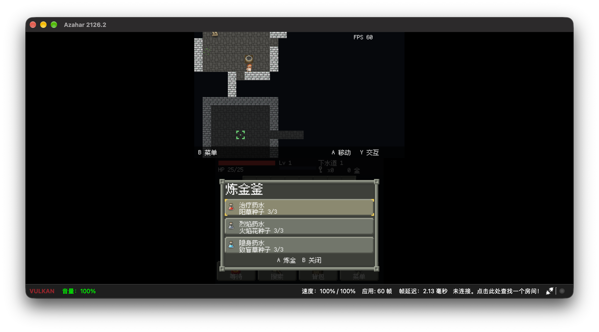
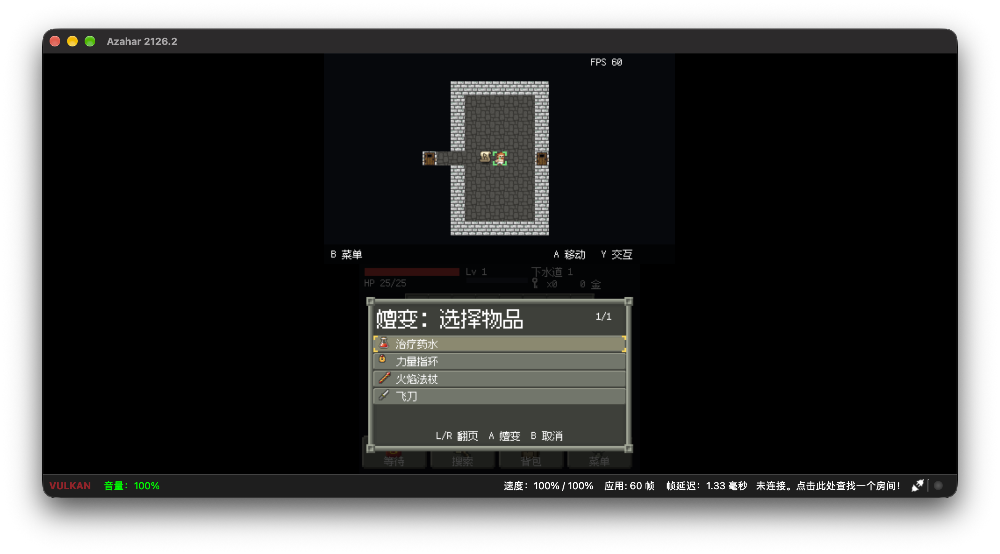
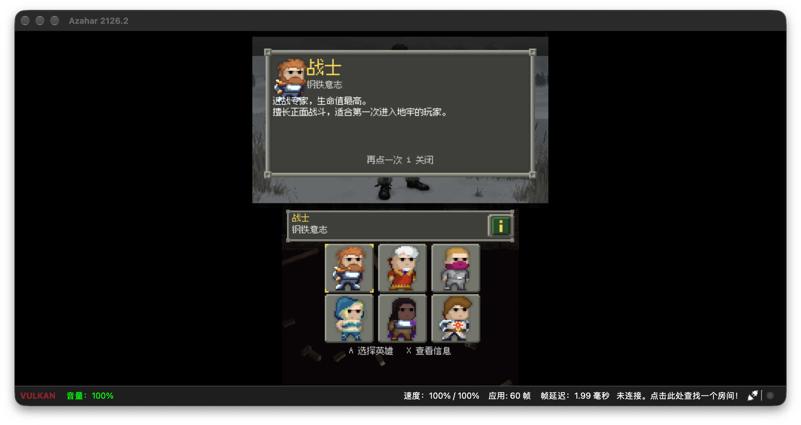
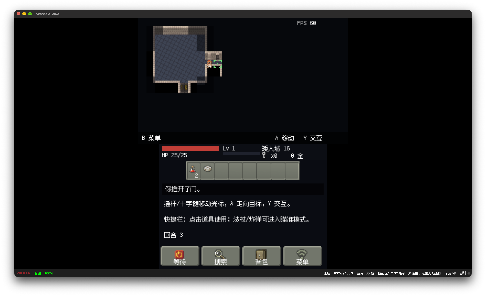
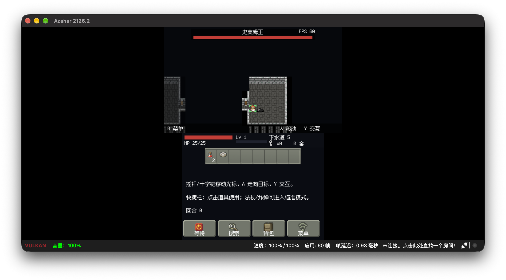

# Shattered Pixel Dungeon — Nintendo 3DS


A **native C++17 port** of [Shattered Pixel Dungeon](https://github.com/00-Evan/shattered-pixel-dungeon)
for the Nintendo 3DS, built with devkitARM, libctru and citro2d.

No JVM, no Dalvik, no APK wrapper, no Java-to-C++ transpiler: game logic, rendering,
input, saves and the dungeon loop are reimplemented from scratch for the 3DS.

**Download 0.1.0alpha:** [GitHub release](https://github.com/YurizonoMika/Shattered-Pixel-Dungeon-3DS/releases/tag/v0.1.0alpha)
— `spd3ds.3dsx` (Homebrew Launcher) or `spd3ds.cia` (installable home-menu title).

[中文简介](#中文简介) · [Screenshots](#screenshots) · [Build](#building) · [Controls](#controls) · [Roadmap](#roadmap)

> **Status: complete 25-floor run, five regions, full save/load.** All five SPD
> regions are playable from floor 1 to Yog-Dzewa on floor 25, with region mobs,
> bosses, NPCs, shops, interactables and area events. Content breadth is still smaller
> than upstream SPD — see [Roadmap](#roadmap).

## 中文简介

这是 Shattered Pixel Dungeon 的 **3DS 原生 C++ 移植原型**：不运行 JVM、不运行 APK、
不用转译器。上下双屏菜单、6 英雄选择、**25 层 / 5 个区域**、回合制移动/战斗、
5 个 Boss、 NPC/商店/任务、装备与法杖、交互物、HUD、对话和**完整存档**都已跑通，
并且直接使用原版美术素材。

- 目标机型：Old 3DS / New 3DS（主要按 Old 3DS 的 400×240 + 320×240 设计）
- 开发环境：macOS + devkitPro（Linux 同样可用）
- 许可：GPL-3.0（与上游一致）

## Screenshots

| Title | Hero select |
| --- | --- |
|  |  |
| **Save slots** | **In-game dual screen** |
|  |  |
| **NPC dialog (top screen)** | **Backpack (SPD-style grid)** |
|  |  |
| **Item details / actions** | **Pause menu (talents)** |
|  |  |
| **Alchemy** | **Shop** |
|  |  |
| **Transmutation picker** | **Hero info** |
|  |  |
| **Fog of war** | **Shop** |
|  |  |
| **Prison (6–10)** | **Caves (11–15)** |
|  |  |
| **City (16–20)** | **Halls boss (21–25)** |
|  |  |

## Features

### Front-end

- **Title**: original logo, parallax background that continues across both screens,
  three buttons (`进入地牢` / `排行榜` / `设置`) with a yellow corner cursor,
  D-pad / Circle Pad / touch input.
- **Local rankings**: top scores written to `sdmc:/3ds/spd/scores.bin`.
- **Settings**: tabbed UI on the bottom screen, title logo kept on top, back button,
  values persisted to `sdmc:/3ds/spd/settings.bin`.
- **Save slots**: 2×2 layout — three slots + `新游戏`, with hero icon, depth, level,
  HP bar and score.
- **Hero select**: splash art on top, name + `i` info button + 2×3 portrait grid on
  the bottom; the info popup shows title and description; tap the selected hero twice
  to start.

### Dungeon (25 floors / 5 regions)

| Floors | Region | Boss | Area events |
| --- | --- | --- | --- |
| 1–5 | 下水道 | 史莱姆王 | 幽魂护符任务（2–4 层） |
| 6–10 | 监狱 | 天狗 | 制杖师任务（7–9 层）、商店（6 层） |
| 11–15 | 洞穴 | DM-300 | 铁匠任务（12–14 层）、商店（11 层） |
| 16–20 | 矮人城 | 矮人国王 | 小鬼任务（17–19 层）、商店（16 层）、20 层小鬼商店 |
| 21–25 | 恶魔大厅 | 尤格-泽瓦 | 最终 Boss、通关结算 |

- Region-specific tilesets (`tiles_sewers/prison/caves/city/halls`), room-and-corridor
  generation, doors, secret doors, stairs, water/grass, and boss-gated stairs.
- **28 enemy types** across the five regions (rats/gnolls/crabs, skeletons/
  thieves/guards, bats/brutes/shamans/spiders, golems/monks/warlocks, demons/eyes/
  rippers/wraiths), each with idle/run animation and smooth movement.
- **Bosses**: 史莱姆王, 天狗, DM-300, 矮人国王, 尤格-泽瓦 — unique sprites, boss HP bar,
  locked stairs until defeated, tier+1 equipment drops.
- **NPCs**: 幽魂 (amulet quest), 店主 (per-region shop), 铁匠 (pay 40 gold for a weapon
  upgrade), 小鬼 (collect 3 tokens on floors 16–19 for a reward).
- **Interactables / decorations**: chests, locked chests, mimics, wells,
  bookshelves, alchemy pots, statues, tombs, plants, barricades, hidden traps and
  quest tokens. Search reveals traps and secret doors with SPD's blue
  `CheckedCell` pulse.
- **Shops**: shops on depths 6/11/16 plus the Imp's depth-20 shop after his quest.
- **90 item definitions**: 15 weapons (tiers 1–5), 6 armor tiers, 13 wands,
  11 potions, 11 scrolls, 8 rings, 3 food types, 3 bombs, 3 throwing weapons,
  3 seeds, keys/gold/quest items.
- **Rings** with two equipment slots: might, accuracy, evasion, haste, wealth,
  energy, force and elements, each with passive combat/economy effects.
- **Scroll of Transmutation** now opens an inventory selector and changes the
  chosen item into a random item of the same category (weapon tier is preserved),
  instead of rolling a random inventory item.
- **Status effects**: haste, invisibility, levitation, mind vision, might, rage,
  sleep and terror are applied by potions, scrolls, wands, seeds and bombs.
- **Wands**: 13 types (single-target, AoE, beam, root, knockback, shield, heal,
  lifesteal, prismatic) with charges, recharge and per-wand behaviour.
- **Doors auto-close**: entering opens a door; leaving closes it again only
  when no character or floor item remains on the tile (SPD `Door.leave`).
- **Wall occlusion**: wall tops, side-door faces and bottom-wall overhangs are
  drawn **above characters**, so the bottom wall lip covers the part of a
  character standing in front of it; characters can never occupy a wall tile.
- **Fog of war**: SPD-style visible / visited / mapped / invisible states.
  Visited cells use the 0x99 black veil, scroll-mapped cells the blue
  `0x99193366` veil, unseen cells are black. Internal walls use SPD's split
  left/right fog halves; camera-facing walls take the darker of the wall and
  the tile below.
- **Field of view**: radius 8 with wall-aware line of sight (radius 5 on dark
  floors), matching SPD's `viewDistance`.
- **Search** reproduces SPD's visual: per-tile blue square shrinking with distance
  delay, hero `operate` animation and a floating “搜索中” label.
- **SPD-style backpack**: 5×5 (25-slot) grid, gold/capacity, equipped gear, item
  badges, bag tabs (全部/药水/卷轴/法杖/装备/其他), and a detail panel with
  **使用 / 装备 / 瞄准 / 丢弃 / 关闭**.
- **Targeting mode** for bombs and wands; quick slots show counts/charges.
- Bottom HUD: HP/shield, level/XP, region + floor, keys, gold, 2×4 quick slots,
  wait/search/backpack/pause; search/wait long-press behaves like SPD.
- ABXY dialog overlay with NPC portrait, name, text and four key actions.
- Floor 25 victory screen after Yog-Dzewa.

### Level generation (ported from SPD)

- **Room budget** follows the five region classes: 4–6 / 5–6 / 6–7 / 6–8 / 8–9
  standard rooms, 1–2 / 1–3 / 2–3 / 2–3 / 2–3 special rooms, plus entrance, exit,
  shops (6/11/16), the Imp shop (20) and 2–3 secret rooms per region.
- **Special rooms** are drawn from SPD's equip/consumable rotation and include
  treasury, armory, crypt, pool, magic well, garden, library, storage, laboratory
  (one per region on floor 3/4), statue, sentry, trap/toxic/fire rooms, runestone
  room and crystal vault. Each has one entrance; most are **locked** and place an
  iron key in a standard room.
- **Level feelings** on depths 2+: 50% chance of water, grass, large, traps,
  secrets or dark; large adds rooms/items/mobs, traps doubles traps, secrets adds a
  secret room, dark reduces FOV.
- **Mob rotation** uses SPD's exact depth table (rat/snake/gnoll/swarm/crab/slime,
  skeleton/thief/DM-100/guard/necromancer, bat/brute/shaman/spinner/DM-200,
  ghoul/elemental/warlock/monk/golem, succubus/eye/scorpio), including the 2.5%
  rare additions and 1/50 albino alt. Mob cap is `3 + depth%5 + rand(0..2)`,
  floor 1 spawns 8, and the level refills to the cap every 50 turns (33 dark).
- **Traps**: `NormalIntRange(2, 3 + depth/5)`.
- **Quest placement**: ghost in the exit room (2–4), Wandmaker in the entrance
  room (7–9), Blacksmith (12–14) and Imp (17–19) in their own quest rooms.

### Loot generation (ported from SPD)

- Normal floors roll **3 / 4 / 5 items** at **60% / 30% / 10%**; large floors add 2.
  There is no guaranteed food drop — food comes from mobs and shops.
- Category decks follow SPD's first/second generator deck: weapons 2, armor 2/1,
  missiles 1/2, wands 1, rings 1, potions 8, scrolls 8, seeds 1, stones 1, gold 10
  (artifacts are mapped to rings).
- Item tiers use SPD's per-floor-set table
  `{0,75,20,4,1} / {0,25,50,20,5} / {0,0,40,50,10} / {0,0,20,40,40} / {0,0,0,20,80}`.
- Heap presentation: 1/20 skeleton, 4/20 chest, 1/20 **mimic**, otherwise a floor
  heap; upgradable items can become a **locked chest with a key**.
- Gold piles use SPD's range `30 + 10×depth … 60 + 20×depth`.
- Beasts drop mystery meat; all mobs drop gold 10% of the time.

### Shops (ported from SPD)

- Regular shops spawn on **depths 6, 11 and 16** (`Dungeon.shopOnLevel()`).
  The depth-20 shop is the Ambitious Imp's and only appears if his quest is done.
- Stock follows SPD's category list: current-tier melee weapon, matching armor,
  a stack of throwing weapons, a healing potion + 2 random potions, magic mapping /
  identify / remove curse + a random scroll, 2 rations, a bomb, an Ankh, and a
  30% chance of a wand or ring.
- Prices use SPD's formula `value × quantity × 5 × (depth/5 + 1)` — 10× value in
  the first shop, 15× in the second, 20× in the third and 25× in the last.
- Selling gives `value × quantity × (depth/5 + 1) / 2` (about 1/10 of the buy
  price) and the last **3 sold items** can be bought back at the same price.
- Shop UI has 购买 / 出售 / 回购 tabs, 6 rows per page, **X** switches tabs,
  **L/R** pages, **A** trades and **B** closes.
- Shopkeeper warn/flee is implemented: damaging or debuffing him warns once,
  the second offense makes him vanish with all wares (saved per floor).
- Bag stock: Potion Bandolier / Scroll Holder / Magical Holster, each +5 slots;
  also sells an Ankh, Stone of Augmentation and tipped darts.

### NPC quests (ported from SPD)

| NPC | Floors | Task | Reward |
| --- | --- | --- | --- |
| Sad Ghost | 2–4 | Kill the floor's quest miniboss (Fetid Rat / Gnoll Trickster / Great Crab) | Choose a weapon or armor (tier 2–5, upgrade 0–3) |
| Old Wandmaker | 7–9 | Retrieve corpse dust from behind barricades | Choose one of two wands (+1…+3) |
| Troll Blacksmith | 12–14 | Collect 15 dark gold ore | Upgrade weapon or armor by +1 |
| Ambitious Imp | 17–19 | Kill 5 monks or 4 golems | +2 ring, unlocks the depth-20 shop |

Quest floors are rolled per run with SPD's probabilities (ghost 2–4, Wandmaker
7–9, Blacksmith 12–14, Imp 17–19) and stored in the save. Quest items are
non-sellable; the ghost disappears after the reward, and the Imp reappears as the
floor-20 shopkeeper. Picking up corpse dust spawns wraiths every few turns until
the Wandmaker is paid; the Blacksmith lends a pickaxe and seals a mine area behind
breakable barricades (implemented as a room on the same floor, not a separate
sub-level).

### Sources

Implementation was cross-checked against:

- [Shopkeeper (Pixel Dungeon Wiki)](https://pixeldungeon.fandom.com/wiki/Shopkeeper)
- [Special Rooms / Shop](https://pixeldungeon.fandom.com/wiki/Shattered_Pixel_Dungeon/Special_Rooms)
- [Shop (Pixel Dungeon Wiki)](https://pixeldungeon.wiki/Shop)
- [NPCs and Quests](https://pixeldungeon.fandom.com/wiki/Shattered_Pixel_Dungeon/Quests)
- [Quest](https://pixeldungeon.fandom.com/wiki/Quest)
- [Sad Ghost](https://pixeldungeon.fandom.com/wiki/Sad_ghost)

### Saves

Each slot is a versioned binary snapshot (~5 KB, format v9): seed/RNG, floor, player stats,
inventory, equipped weapon/armor, wand charges, map tiles, explored tiles, mobs,
floor items (including gold amounts and chest contents), features/traps, shop stock
and sold flags, per-region boss flags, quest tokens and the full 25-slot bag. Load restores the exact
run; leaving the game auto-saves. Slot files from older save formats are detected and
ignored safely (delete `sdmc:/3ds/spd/slot*.bin` after upgrading if needed).

## Controls

| Context | Input |
| --- | --- |
| Menus | D-pad / Circle Pad move, **A** confirm, **B** back, bottom-screen touch supported |
| Settings | ← → switch tab, ↑ ↓ select, **A** change value |
| Hero select | **A** select, **A** again on the same hero to start, **X** info popup |
| Game cursor | D-pad / Circle Pad (hold to repeat), **A** walk to tile, **Y** interact |
| Game actions | **B** pause menu (exit via the menu), **X** backpack, **L** wait, **R** search, **START** pause |
| Targeting | **A** cast/throw at cursor, **B** cancel |
| Backpack | **L/R** switch tab (全部/药水/卷轴/法杖/装备/其他), D-pad select, **A** details, **A** use/equip/aim, **X** drop, **B** close; tabs and slots are touchable |
| Dialog | **A / B / X / Y** pick the matching option |

## Building

### Requirements

- devkitPro `3ds-dev` (devkitARM r68+, libctru 2.7+, citro2d 1.7+)
- `make`, `git`, `ffmpeg`, Python 3 with `venv`
- A clone of the upstream assets (GPL-3.0)

### Steps

```bash
git clone https://github.com/YurizonoMika/Shattered-Pixel-Dungeon-3DS.git
cd Shattered-Pixel-Dungeon-3DS

# 1. Upstream assets (only core assets are needed)
git clone --depth 1 https://github.com/00-Evan/shattered-pixel-dungeon.git ../spd-upstream
bash tools/prepare-assets.sh          # copy PNGs + hero art, generate .t3s

# 2. CJK bitmap font (OFL, pinned SHA-256)
bash tools/fetch-fonts.sh
python3 -m venv tools/venv
tools/venv/bin/pip install pillow fonttools
tools/venv/bin/python tools/gen_font.py

# 3. Build
export DEVKITPRO=/opt/devkitpro
export DEVKITARM=$DEVKITPRO/devkitARM
export PATH=$DEVKITPRO/tools/bin:$DEVKITARM/bin:$PATH
make
```

The build produces `spd3ds.3dsx` (~2.5 MB). Textures are packed into the RomFS at
build time by `tex3ds`; nothing is loaded from the SD card except saves/settings.

To build the installable CIA as well:

```bash
make cia
# → spd3ds.cia (~2.4 MB), requires makerom:
#   https://github.com/3DSGuy/Project_CTR/releases
```

`banner.bin`, `banner.png`, `banner.wav`, `icon.png` and `spd3ds.rsf` are checked in,
so only `makerom` is needed. To regenerate the banner after changing its art:

```bash
bannertool makebanner -i banner.png -a banner.wav -o banner.bin
```

Tested against upstream commit
[`57a4e06`](https://github.com/00-Evan/shattered-pixel-dungeon/commit/57a4e06a4caf162446d1c28caa7983f0493fecf0).

### Running

```bash
# Azahar (Citra fork) — windowed
open -a "$HOME/Applications/Azahar.app" "$PWD/spd3ds.3dsx"

# Real hardware (Homebrew Launcher with NetLoader)
3dslink spd3ds.3dsx
```

### Installing the CIA

1. Copy `spd3ds.cia` to the SD card.
2. Install it with **FBI** or **GodMode9** (Luma3DS signature patches enabled, like
   any homebrew CIA).
3. Launch **Shattered PD 3DS** from the home menu.

The title ID is `00040000051D3000`. Save slots, settings and scores stay in
`sdmc:/3ds/spd/`, the same location used by the 3DSX build, so both versions share
their saves.

> If Azahar's default window is too short, maximize it or use fullscreen; the bottom
> screen's last few pixels can be clipped by the window size.

### Troubleshooting

| Symptom | Fix |
| --- | --- |
| Black screens / `[assets] missing romfs:/gfx/...` | Run `tools/prepare-assets.sh` and `make` again |
| Chinese glyphs show as boxes | New strings were added → rerun `tools/gen_font.py` |
| `DEVKITARM` is not set | `source setup/env.sh` from the 3ds-dev workspace, or export it manually |
| `sha256` command not found | macOS: `shasum`; Linux: install `coreutils` / use `sha256sum` |

## Architecture

```text
source/
├── main.cpp          # boot, input, scene state machine, menus/settings/saves/heroes
├── game_screen.cpp   # in-game top/bottom rendering, HUD, dialogs, backpack, pause
├── game.cpp          # level generation, FOV, turn loop, AI, items, save metadata
├── assets.cpp        # texture loading, 9-patch, grid slicing, bitmap text
├── common.h / app.h  # shared state and drawing/input interfaces
└── font_glyphs.h     # generated by tools/gen_font.py
gfx/                  # upstream PNGs + tex3ds descriptors
romfs/gfx/            # generated .t3x textures embedded by 3dsxtool
tools/                # asset prep, font generation, dev helpers
```

- Two `C2D_RenderTarget`s (top 400×240, bottom 320×240) are drawn every frame.
- `C3D_DepthTest(true, GPU_ALWAYS, ...)` keeps strict submission order for 2D UI.
- All textures use `GPU_NEAREST` filtering to preserve pixel art.
- Character frames follow SPD's sheets (hero/gnoll 12×15, rat 16×15, crab 16×16)
  with the same idle/run frame tables, drawn with SPD's tile-relative offsets.
- Player movement is a queued BFS path: one tile per turn, with a short visual
  interpolation, so turns stay deterministic while sprites move smoothly.
- Text is a generated white-alpha glyph atlas tinted at runtime with `C2D_TintMult`.
- Saves use a fixed-size `GameDisk` struct (`source/game.h`) with magic + version
  fields; `Game::slot_meta` reads just the header for the slot list.

### Asset pipeline

1. `tools/prepare-assets.sh` copies the sheets we need and converts hero splash JPGs
   to 400px-wide PNGs.
2. Each PNG gets a one-line `.t3s`; `tex3ds` turns it into a `.t3x` in `romfs/gfx/`.
3. The runtime slices grid sheets with UVs derived from SPD's `xy(col,row)` layout
   (`FLOOR=0`, `EXIT=17`, `WATER=32`, `FLAT_WALL=48`, `FLAT_DOOR=56`).
4. 9-patch insets come from SPD's `Chrome.java` (`WINDOW`, `GREY_BUTTON`, tabs).

### Font pipeline

`tools/gen_font.py` scans `source/*.cpp` and `source/*.h` for every non-ASCII
character, renders it with **Fusion Pixel 12px** (OFL), packs a 512×N atlas and emits
`source/font_glyphs.h` (codepoint → rect + metrics). Add UI text → rerun the script.
Only the glyphs actually used are included, keeping the atlas small.

Readability rules used by the renderer:

- only **integer scales** (1× body, 2× headings) — fractional downscaling with
  `GPU_NEAREST` drops pixel rows and makes CJK look broken;
- every glyph is snapped to the integer pixel grid;
- the atlas is **1-bit alpha** (thresholded in `gen_font.py`) and text is drawn with
  **no drop shadow**, so upscaled glyphs stay crisp instead of growing a grey halo;
- body text uses high-contrast near-white instead of mid-grey.

> If text looks soft in Azahar, scale the window by an integer factor (4× gives
> 1600×960 for the top screen and 1280×960 for the bottom screen). Non-integer
> window scaling blurs the whole framebuffer, not just text.

### Sprite fidelity

Every item's sprite index is taken from SPD's `ItemSpriteSheet.java`
(`xy(x, y) = (x-1) + 16*(y-1)`); the 90 entries are checked by rendering each
definition next to its real `items.png` cell:

```bash
tools/venv/bin/python tools/item_audit.py
# → docs/item_audit.png
```

[Open the full 90-item audit sheet](docs/item_audit.png).

Map tiles follow `DungeonTileSheet.java` instead of the old flat-wall look:

- wall cells with floor **below** use the raised front face (`80..83`); cells
  with another wall below use the **internal-wall top material** (`144..159`).
  The **bottom wall seen from inside a room** is the separate **overhang
  material** (`192..207`) drawn on the floor cell above the wall; nothing is
  rotated,
- doors in horizontal walls use `112/113/114`; doors in vertical walls use the
  separate **side-door** material (`116` threshold plus `227/228` above), also
  no rotation,
- doors use the raised door frames (`112` closed / `113` open),
- water uses the 16-way stitched tiles (`32..47`),
- chests / locked chests / tombs use `ItemSpriteSheet` cells `36 / 37 / 34`,
- alchemy pot, barricade, bookshelf and statue use the raised feature cells
  (`120 / 121 / 92 / 128`),
- floors and grass occasionally use their SPD alternate variants (`6 / 8`).

The audit caught and fixed meat-vs-ration food icons, the pickaxe showing a
mage's staff, the augmentation stone showing a crown, quest dust/ore/token all
sharing the amulet sprite, the three bag sprites, and weapons that were mapped
to the wrong tier.

## Debug

Drop `sdmc:/3ds/spd/scene.txt` (Azahar:
`~/Library/Application Support/Azahar/sdmc/3ds/spd/scene.txt`) and relaunch:

| Value | Scene |
| --- | --- |
| 1 | Rankings |
| 2 | Settings |
| 3 | Save slots |
| 4 | Hero select |
| 5 | New game |
| 10 | Game + NPC dialog |
| 11 | Game + backpack |
| 12 | Game + pause |
| 13 | Game + targeting |
| 14 | Hero select + info popup |
| 15 | Game with starter gear/wands/bombs |
| 16 | Same as 15 + backpack open |
| 17 | Same as 15 + wand targeting |
| 18 | Floor 3 next to the boss |
| 19 | Floor 2 next to the quest amulet |
| 21 | Frozen mid-walk pose (animation check) |
| 22 | Frozen search effect (CheckedCell + operate pose) |
| 23 | Backpack with the item-detail panel open |
| 24 | Backpack on the 药水 tab (filter demo) |
| 25–29 | Boss floors 5 / 10 / 15 / 20 / 25 |
| 30 | Prison (floor 6) |
| 31 | Caves (floor 11) |
| 32 | City (floor 16) |
| 33 | Halls (floor 21) |
| 34 | Blacksmith dialog (floor 12) |
| 35 | Imp quest dialog (floor 17) |
| 36 | Shop UI (floor 6) |
| 54 | Shop UI (floor 6, fresh run) |
| 55–58 | Ghost / Wandmaker / Blacksmith / Imp dialogs |
| 59 | Floor-20 Imp shop |
| 60 | Ghost quest accepted (miniboss spawned) |
| 61 | Ghost reward choice |
| 62–64 | Wandmaker / Blacksmith / Imp quest accepted |
| 65 | Generate all 25 floors (smoke test) |
| 70 | Alchemy UI |
| 72 | Scroll of Transmutation item selector |
| 73 | All 90 item icons on one screen (sprite audit) |
| 74 | Generate all floors and print room/mob/item/door audit |
| 75 | Spawn the new depth-rotation enemies for a visual check |
| 76 | Clean enemy gallery (no items/features) |
| 77 | Jump next to a locked side door |
| 78 | Visited / mapped fog test |
| 79 | Door auto-close self-test (writes to log) |
| 71 | Pause menu with talent progress |
| 40 | Backpack with rings/missiles/seeds |
| 41 | Ring detail panel |

The app appends boot/scene-boot diagnostics to `log.txt` in the same folder, which is
useful when the emulator shows an exception dialog.

## Roadmap

- [x] Dual-screen shell, settings, saves, hero select
- [x] Dungeon generation, FOV, turn loop, mobs, items, HUD
- [x] CJK bitmap font pipeline
- [x] Full save/load (map, mobs, inventory, equipment, quest/boss state)
- [x] All 25 floors and 5 regions with region mobs, bosses, NPCs, shops,
      interactables and area events
- [x] Full item table across all categories (weapons/armor/wands/potions/
      scrolls/rings/bombs/missiles/seeds) with gameplay effects
- [x] Shopkeeper warn/flee, bags, alchemy UI, Stone of Augmentation, tipped darts
- [x] Integer-scaled, shadow-free UI text; fixed multiline wrapping measurement
- [x] Wandmaker wraith spawns, pickaxe/ore mine area, class-neutral talent tiers
- [x] SPD room budgets, special-room rotation, locked special rooms + keys
- [x] SPD depth-specific mob rotations, mob cap, respawns, rare alts
- [x] SPD level feelings, traps, loot decks, chests/mimics, gold range
- [x] CIA packaging (makerom, banner + icon, RSF permissions)
- [ ] True Old Mine / Imp Vault sub-levels (currently rooms on the same floor)
- [ ] Boss arenas as separate levels (regular rooms + boss room for now)
- [ ] Full class-specific 3-way talent trees (currently 4 fixed talent tiers)
- [ ] Artifacts, trinkets, exotic consumables and full alchemy recipes
- [ ] Exact layouts for every special room (crystal/sacrifice/fire variants are simplified)
- [ ] Audio: `ndsp` or SDL2_mixer (library already built for 3DS)
- [ ] Difficulty tuning across all 25 floors
- [ ] Old 3DS performance and memory tuning
- [ ] GitHub Actions build (devkitPro container)

## Credits

- **Shattered Pixel Dungeon** by Evan Debenham and contributors — game design and
  all art/audio assets (GPL-3.0).
- **devkitPro** — devkitARM, libctru, citro2d, tex3ds.
- **Fusion Pixel Font** by TakWolf — OFL-1.1.
- **Azahar** — 3DS emulator used for testing.

This project is not affiliated with Nintendo or with the Shattered Pixel Dungeon
team. Only port code in this repository is original to this project.

## License

GPL-3.0, matching upstream. See [LICENSE](LICENSE).

Assets copied from the upstream game remain GPL-3.0; do not redistribute them
separately from a GPL-compatible work.
