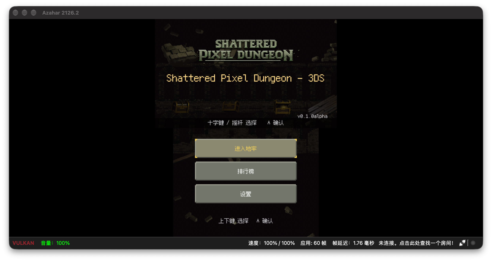
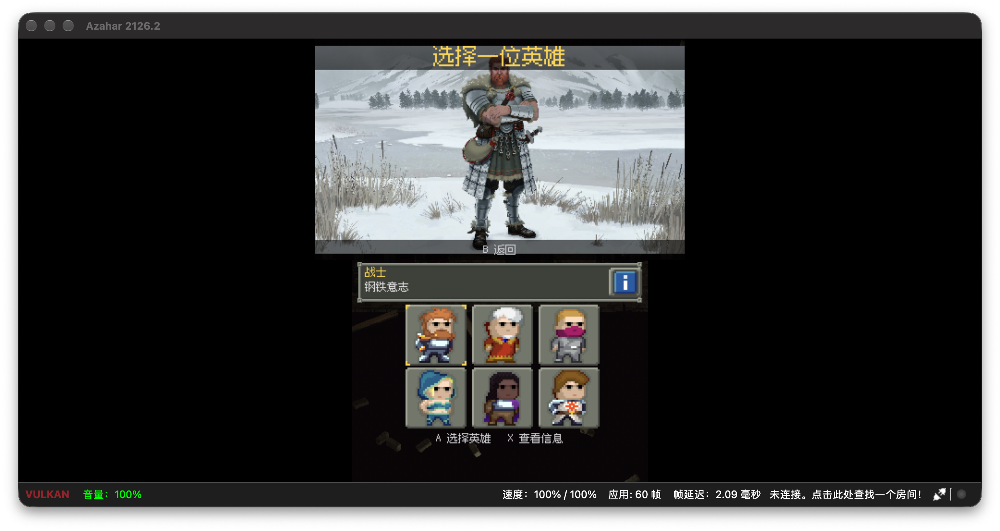
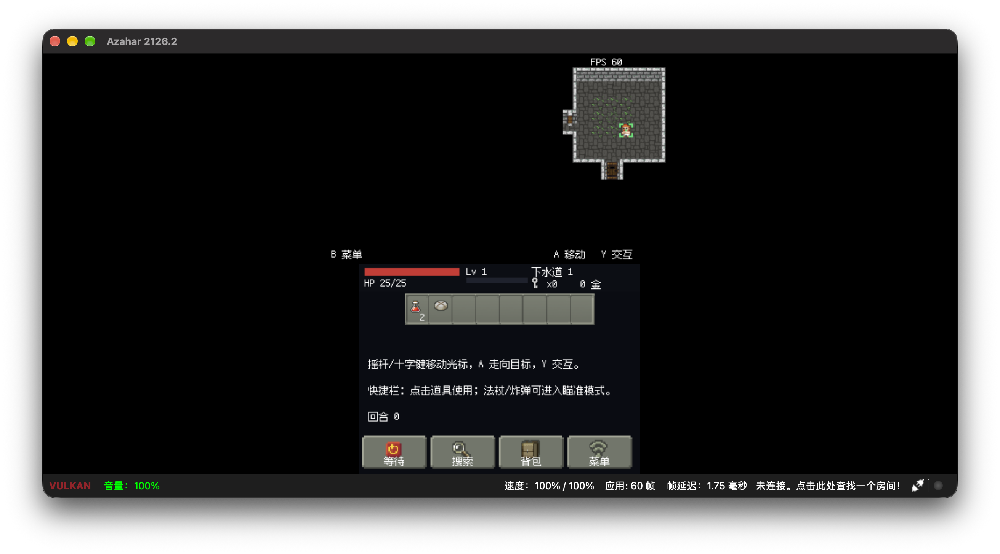
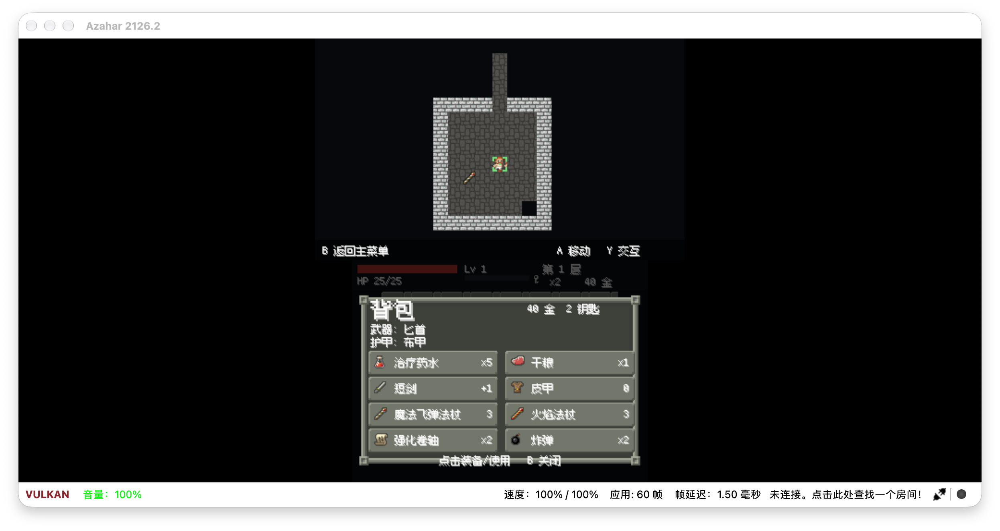
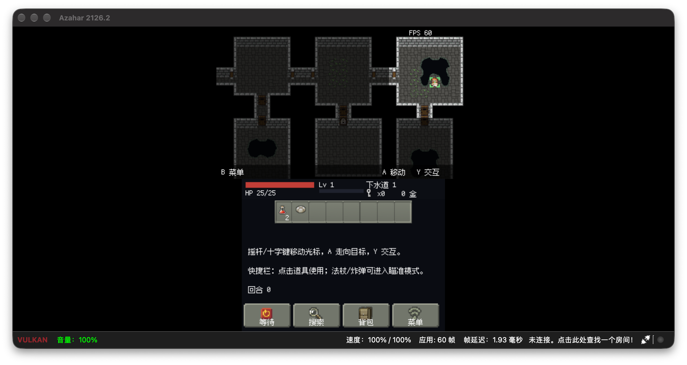
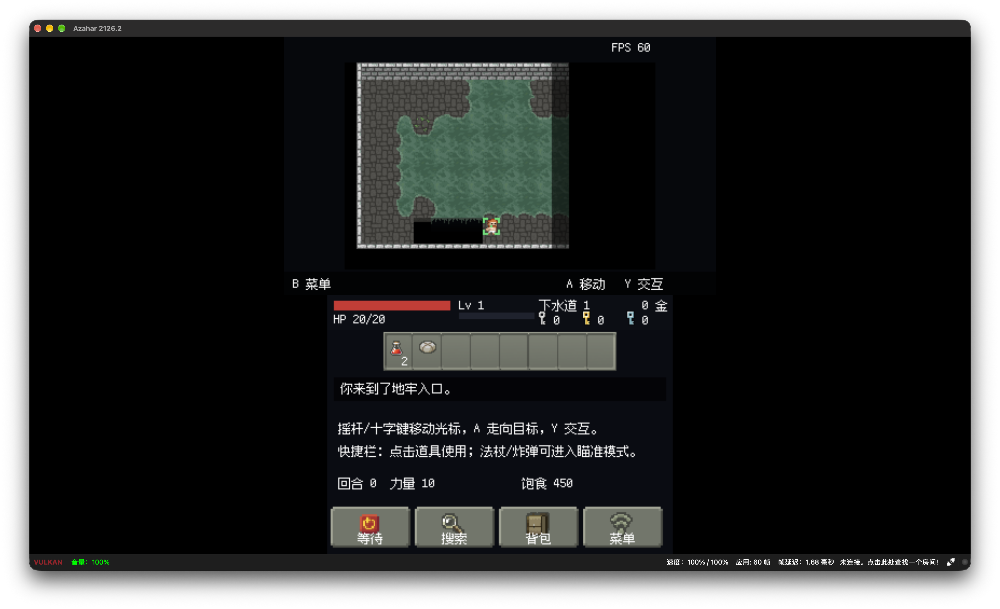

# 破碎的像素地牢 · Nintendo 3DS

[English](README.md) · **简体中文**

这是 [Shattered Pixel Dungeon](https://github.com/00-Evan/shattered-pixel-dungeon) 的 Nintendo 3DS 原生 C++17 移植版。游戏使用 devkitARM、libctru 和 citro2d，以及原版美术素材；运行时不需要 JVM、APK 或转译器。

[发布日志](https://github.com/YurizonoMika/Shattered-Pixel-Dungeon-3DS/releases) · [截图](#截图) · [操作](#操作) · [构建](#构建) · [开发计划](#开发计划)

## 下载和安装

v0.1.7alpha 为武器攻击加入命中和闪避判定，护甲可以完全抵消物理伤害。敌人和英雄死亡时会倒下并淡出，英雄动画播完后才显示结算框。

| 安装包 | 用途 |
| --- | --- |
| [`spd3ds.3dsx`](https://github.com/YurizonoMika/Shattered-Pixel-Dungeon-3DS/releases/download/v0.1.8alpha/spd3ds.3dsx) | 在 Azahar 中直接打开，或放到 SD 卡的 `/3ds/` 下，通过 Homebrew Launcher 启动。 |
| [`spd3ds.cia`](https://github.com/YurizonoMika/Shattered-Pixel-Dungeon-3DS/releases/download/v0.1.8alpha/spd3ds.cia) | 在启用 Luma3DS 签名补丁的主机上通过 FBI 或 GodMode9 安装，再从 HOME 菜单启动 **Shattered PD 3DS**。 |

CIA 标题 ID 为 `00040000051D3000`。CIA 和 3DSX 共用 `sdmc:/3ds/spd/` 下的存档、设置和排行榜。升级 Alpha 版前建议备份该目录。

## 截图

| 标题画面 | 英雄选择 |
| --- | --- |
|  |  |
| **双屏游戏画面** | **背包** |
|  |  |
| **战争迷雾** | **地图缩放** |
|  |  |

## 功能与进度

- 可从第 1 层玩到第 25 层，包含五个区域和五位首领。支持六位英雄、三个存档槽、本地排行榜和双屏菜单。
- 回合制移动与战斗、装备和消耗品、快捷栏、商店买卖与回购、任务、炼金及简化天赋。铁钥匙、金钥匙和水晶钥匙各有对应的锁；搜索能揭示暗门和陷阱，但不会解除陷阱。
- 普通层使用移植自 v4.0.2 的单环和双环构建器，支持可变尺寸布局、支路、连接房与迷宫。水草区域使用原版斑块算法和五个区域的参数。普通层会投放食物，大型楼层额外投放一份。
- 地图有可见、已探索、卷轴揭示和未探索四种雾状态。门离开后在无人或物品占用时自动关闭。墙体和侧门使用独立前景素材；水纹以每秒 5 像素滚动，岸边和雾叠加在水面之上。
- 隧道、周边走廊、环形通道和深渊桥分别按原版绘制；柱阵房、隔间房和圆墙房已有各自的内部地形。
- 目前**不能用相同种子复现原版整层地图**。其余房间内部绘制、特殊房和暗房抽选、任务房生成、首领阶段和任务子地图仍未完整移植。已验证的范围见 [v4.0.2 楼层机制对照（英文）](docs/floor-mechanics-parity.md)。

| 层数 | 区域 | 首领 |
| --- | --- | --- |
| 1–5 | 下水道 | 史莱姆王 |
| 6–10 | 监狱 | 天狗 |
| 11–15 | 洞穴 | DM-300 |
| 16–20 | 矮人城 | 矮人国王 |
| 21–25 | 恶魔大厅 | 尤格-泽瓦 |

### 存档兼容

当前存档格式为 **V10**，记录地图和雾、角色和物品、各类钥匙数量、掉落牌库进度，以及任务、首领和补怪状态。离开游戏时自动存档。**v0.1.0alpha 的 V9 存档仍可读取**：旧存档的当前层暂用共用钥匙计数，下楼后生成的地图使用新版规则。

## 操作

| 场景 | 按键 |
| --- | --- |
| 菜单 | 十字键或摇杆移动，**A** 确认，**B** 返回；下屏支持触控。 |
| 英雄选择 | **A** 选中，再按 **A** 开始；**X** 查看英雄说明。 |
| 地图 | 十字键或摇杆移动光标，**A** 走向光标，**Y** 交互。 |
| 游戏快捷操作 | **B / START** 暂停，**X** 背包；按住 **L / R** 缩小或放大（0.75×–2×）；**ZL / ZR** 等待或搜索，也可点下屏按钮。 |
| 瞄准 | **A** 对光标位置施法或投掷，**B** 取消。 |
| 背包 | **L / R** 切换分类，十字键选物品，**A** 查看详情并确认操作，**X** 丢弃，**B** 关闭。 |
| 对话 | 按 **A / B / X / Y** 选择对应选项。 |

## 构建

需要 devkitPro `3ds-dev`（devkitARM r68+、libctru 2.7+、citro2d 1.7+）、`make`、`git`、`ffmpeg` 及支持 `venv` 的 Python 3。CIA 打包还需要 [makerom](https://github.com/3DSGuy/Project_CTR/releases)。

```bash
git clone https://github.com/YurizonoMika/Shattered-Pixel-Dungeon-3DS.git
cd Shattered-Pixel-Dungeon-3DS

# 准备 v4.0.2 美术素材和中文字库
git clone --depth 1 --branch v4.0.2 https://github.com/00-Evan/shattered-pixel-dungeon.git ../spd-upstream
bash tools/prepare-assets.sh
bash tools/fetch-fonts.sh
python3 -m venv tools/venv
tools/venv/bin/pip install pillow fonttools
tools/venv/bin/python tools/gen_font.py

# 按 devkitPro 的实际安装位置调整路径
export DEVKITPRO=/opt/devkitpro
export DEVKITARM=$DEVKITPRO/devkitARM
export PATH=$DEVKITPRO/tools/bin:$DEVKITARM/bin:$PATH
make
make cia  # 可选，需要 makerom
```

`make` 会把纹理打包进 RomFS，产出 `spd3ds.3dsx`。实机也可在 Homebrew Launcher 内启用 NetLoader 后使用 `3dslink spd3ds.3dsx`。Azahar 若裁掉下屏底部，可放大窗口或使用全屏。如果构建后报告素材缺失，重新运行 `bash tools/prepare-assets.sh` 再构建；新增中文 UI 字符后，重新生成字库。

## 实现与调试

- `source/game.cpp` 负责楼层生成、回合、寻路调用和存档，`source/game_screen.cpp` 负责双屏渲染。`gfx/` 存放素材，构建时由 `tex3ds` 打包。角色、地图和字库采用最近邻采样，保留像素边缘。
- 可在 `sdmc:/3ds/spd/scene.txt` 写入场景编号后重启：`85/86` 检查门与缩放，`87` 检查 800 层生成，`88` 检查寻路，`91` 检查补怪，`92` 检查钥匙、陷阱与存读档，`93–97` 检查五个区域的水纹和雾，`98` 预览生成的深渊通道。Azahar 的日志位于 `~/Library/Application Support/Azahar/sdmc/3ds/spd/log.txt`；完整场景表见[英文 README](README.md#debug)。
- `bash tools/check-floor-layout.sh ../spd-upstream` 用相同输入对照 v4.0.2 的房间构建、斑块和迷宫；`bash tools/check-pathfinder.sh ../spd-upstream` 对照寻路。Java 只用于在电脑上跑对照测试，不参与游戏构建或运行。

## 开发计划

- 同步原版房型抽选、各房型绘制，以及完整的特殊房、暗房、陷阱和掉落规则。
- 移植五个首领的独立地图与阶段脚本，以及旧矿洞和小鬼宝库任务子地图。
- 补齐职业天赋树、神器、饰品、炼金配方及音效，继续优化 Old 3DS 性能。

## 致谢与许可

感谢 Evan Debenham 与贡献者（Shattered Pixel Dungeon）、devkitPro（3DS 工具链）、TakWolf（[Fusion Pixel Font](https://github.com/TakWolf/fusion-pixel-font)，OFL-1.1）和 Azahar 项目（模拟器测试）。本项目与 Nintendo 或上游开发团队无隶属关系。

移植代码与上游素材遵循 GPL-3.0，见 [LICENSE](LICENSE) 和 [CREDITS.md](CREDITS.md)。
